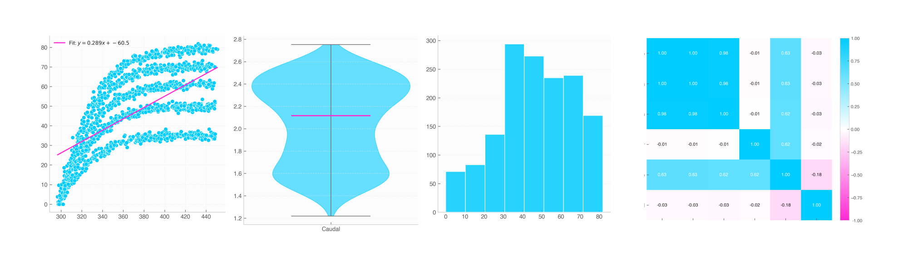

# **ElevenOne**: *your perfect lab assistant*

[](https://pypistats.org/packages/elevenone)
[](https://pypi.org/project/elevenone/)
[](https://pypi.org/project/elevenone/)




ElevenOne is a Python library for seamless scientific unit management, rigorous laboratory data processing, signal analysis, and automated publication-ready plotting.

Some of the things ElevenOne can do include:

- Handling of physical units
- Automatic data loading with unit detection
- High-level scientific plotting and visualizations
- Automated publication-grade scientific reports
- Numerous models of data fitting
- Advanced signal processing and peak detection

---

## Handling of physical units

ElevenOne features a complete internal system for handling physical units. Among the things it can do are the use and management of physical units, operations with them, and conversion between them.

```python
from elevenone import *

speed = 90 * km/h
print(speed.convert_to(m/s))
```

```text
>>> 25 m/s
```

ElevenOne has more than 60 different units to use in your project!

---

## Automatic Data Loading with Unit Detection

ElevenOne can load data directly from CSV or Excel files (`.csv`, `.xls`, `.xlsx`), automatically detecting physical units in column headers (e.g., `Time (s)`, `Pressure [kPa]`) or within data cells.

```python
from elevenone import load_data

# Load data automatically parsing units into Quantity objects
df = load_data("experiment_results.csv")

# Access columns directly; units are preserved and active
print(df["Time"])
print(df["Speed"].mean())
```

---

## High-Level Scientific Plotting

With `Data` objects, you can generate modern, publication-ready plots with built-in unit handling and automatic labeling:

```python
from elevenone import Data, s, m

# Create dataset with units
t = [1, 2, 3, 4, 5] * s
d = [2.1, 4.3, 5.9, 8.1, 10.2] * m

data = Data({"Time": t, "Distance": d})

# Generate line plot with automatic labels
fig, ax = data.plot(x="Time", y="Distance", title="Kinematic Trajectory")

# Scatter plot with linear fit
fig, ax = data.scatter(x="Time", y="Distance", fit=True, title="Linear Fit Analysis")
```

ElevenOne supports multiple visualization modes out of the box:

- `data.plot()`: Line plots with area fills.
- `data.scatter()`: Scatter plots with optional linear fit (`fit=True`).
- `data.errorbar()`: Uncertainty visualization (`xerr`, `yerr`).
- `data.hist()`: Distribution histograms.
- `data.boxplot()` & `data.violin()`: Outlier and density distribution plots.
- `data.residual_plot()`: Residual error analysis for fits.
- `data.pairplot()`: Pairwise correlation grid.
- `data.corr_heatmap()`: Pearson correlation heatmaps.

---


## Automated Scientific Reports

Generate full statistical and visual analytical reports with a single function call in **HTML** or **PDF** format.

```python
from elevenone import load_data, generate_report

# Load laboratory dataset
data = load_data("lab_measurements.xlsx")

# Generate complete HTML report
generate_report(data, output_path="report.html", title="Laboratory Experiment Analysis")

# Export as PDF (requires weasyprint or pdfkit)
generate_report(data, output_path="report.pdf", format_type="pdf")
```

The report automatically compiles dataset overview metrics, descriptive statistics, advanced indicators (skewness, kurtosis, IQR), correlation matrices, and distribution graphs without exposing raw data lines.

---

## Curve Fitting & Model Optimization

ElevenOne provides a flexible curve fitting module designed for scientific data analysis, featuring built-in standard models (linear, polynomial, exponential, power law and logarithmic) as well as support for custom user-defined functions. Fits preserve physical units and compute fitted parameters alongside standard errors and goodness-of-fit metrics ($R^2$, $\chi^2$).

```python
data = Data({
    "Time": [0.0, 1.0, 2.0, 3.0, 4.0] * s,
    "Position": [0.2, 2.1, 4.3, 5.9, 8.2] * m
})

# Add measurement errors
data.set_error("Time", 0.05)       # 0.05 s error on time
data.set_error("Position", 0.2)    # 0.2 m error on position

# Perform linear fit
result = fit_linear(data, x="Time", y="Position")

# Print complete fit summary
print(result)

# Plot data, fit line, and residuals
fig, axes = result.plot(title="Position vs. Time Fit")
```

---

## Signal Processing & Analysis

The `Signal` class provides a comprehensive suite for 1D time-series and experimental signal analysis. It seamlessly tracks physical units across all transformations (Fourier domain, digital filtering, calculus, and peak detection).

```python
import numpy as np
from elevenone import Signal, s, V, Hz

# Create a noisy sinusoidal signal with physical units
t = np.linspace(0, 10, 1000) * s
v = (np.sin(2 * np.pi * 5 * t.value) + 0.3 * np.random.randn(1000)) * V

sig = Signal(x=t, y=v, x_name="Time", y_name="Voltage")

# 1. Digital Filtering (Low-pass Butterworth filter)
filtered_sig = sig.lowpass_filter(cutoff=10 * Hz, order=4)

# 2. Peak Detection & Visualization
fig, ax = filtered_sig.plot_peaks(distance=50, prominence=0.5, title="Filtered Signal Peak Detection")

# 3. Fourier Analysis (FFT & IFFT)
spectrum = filtered_sig.fft()              # Returns a Signal in Frequency domain (Hz vs V)
reconstructed = spectrum.ifft()            # Reconstructs time-series Signal

# 4. Numerical Calculus (Preserving dimensional units)
velocity_sig = sig.differentiate()         # Returns d(Voltage)/d(Time) [V/s]
integrated_sig = sig.integrate()           # Returns ∫(Voltage)d(Time) [V·s]
```

Key features of `Signal` include:

- **Peak & Valley Detection**: `find_peaks()`, `find_valleys()`, and `plot_peaks()` with customizable visual markers and annotations.
- **Digital Filtering**: `lowpass_filter()`, `highpass_filter()`, `bandpass_filter()`, `bandstop_filter()`, `savgol_filter()`, and `moving_average()`.
- **Fourier & Time-Frequency Analysis**: `fft()`, `ifft()`, `stft()`, `istft()`, `psd()`, and `envelope()`.
- **Calculus & Resampling**: `differentiate()`, `integrate()`, `resample()`, `detrend()`, and `remove_offset()`.

---

## Documentation

The complete documentation, including installation instructions, getting-started guides, usage examples, and feature references, is available at:

📚 [ElevenOne Documentation](https://elevenone.readthedocs.io/)

---

## License

ElevenOne is open-source software released under the **MIT License**. You are free to use, modify, and distribute it, including for commercial purposes, provided that the copyright and permission notices are retained.

See the [LICENSE](LICENSE) file for the complete license text.
