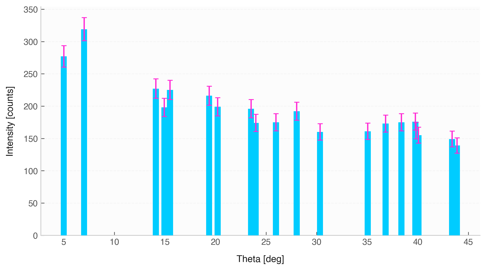

# Bar Plot (`Data.bar`)



The `.bar()` method generates vertical bar charts to compare discrete categories or series measurements. It incorporates uncertainty cap lines and unit-aware axis labels.

## Features & Internal Behavior

* **Automatic Uncertainty Caps:** Renders error caps on top of bars when the dependent variable contains non-zero uncertainties (for datasets with $\le 25$ items).
* **Horizontal Grid Alignment:** Enables horizontal gridlines (`axis='y'`) by default to make reading bar height comparisons easier.
* **Clean Theme Styling:** Removes default borders and applies theme accent colors.

## Basic Usage

```python
import elevenone as eo
from elevenone import Data
from elevenone.basic_units import J

dataset = Data({
    "Material": ["Copper", "Aluminum", "Iron", "Glass"],
    "Energy": [12.4, 28.1, 19.5, 8.2] * J
})
dataset.set_error("Energy", [0.5, 1.0, 0.8, 0.3])

# Create bar chart
fig, ax = dataset.bar(x="Material", y="Energy", title="Absorbed Energy by Material")
```

## Parameter Reference

| Parameter | Type | Default | Description |
| :--- | :--- | :--- | :--- |
| `x` | `str` | *required* | Column name for categories ($x$-axis). |
| `y` | `str` | *required* | Column name for numerical values ($y$-axis). |
| `ax` | `matplotlib.axes.Axes` | `None` | Matplotlib axes object. |
| `figsize` | `tuple` | `(8, 4.5)` | Figure dimensions. |
| `color` | `str` | `None` | Custom bar color. |
| `width` | `float` | `0.6` | Width of the bars (0.0 to 1.0). |
| `title` | `str` | `None` | Plot title. |
| `grid` | `bool` | `True` | Enables horizontal grid lines. |