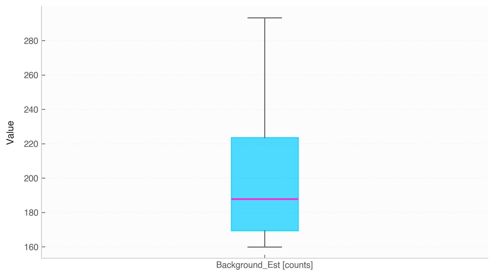

# Box Plot (`Data.boxplot`)



The `.boxplot()` method generates box-and-whisker plots to display statistical distributions, medians, interquartile ranges (IQR), and outliers across numerical variables.

## Features & Internal Behavior

* **Multi-Column Comparison:** Compares all numerical variables automatically if no column list is passed.
* **Custom Styling:** Highlights median lines with accent colors, shades central quartile boxes, and marks outliers as distinct markers.
* **Unit X-Tick Labels:** Converts column names into tick labels formatted with physical unit symbols (`Column [Unit]`).

## Basic Usage

```python
import numpy as np
import elevenone as eo
from elevenone import Data
from elevenone.basic_units import K, kPa

dataset = Data({
    "Temperature": [295, 298, 301, 297, 305, 310, 296] * K,
    "Pressure": [101.3, 102.1, 100.8, 101.5, 103.0, 99.5, 101.8] * kPa
})

# Generate boxplot comparison
fig, ax = dataset.boxplot(columns=["Temperature", "Pressure"], title="Environmental Variable Range")
```

## Parameter Reference

| Parameter | Type | Default | Description |
| :--- | :--- | :--- | :--- |
| `columns` | `list` | `None` | List of column names to plot (defaults to all numeric columns). |
| `ax` | `matplotlib.axes.Axes` | `None` | Target Matplotlib axes. |
| `figsize` | `tuple` | `(8, 4.5)` | Figure dimensions `(width, height)`. |
| `title` | `str` | `None` | Plot title. |
| `ylabel` | `str` | `'Value'` | Custom label for $y$-axis. |
| `grid` | `bool` | `True` | Enables horizontal grid lines. |