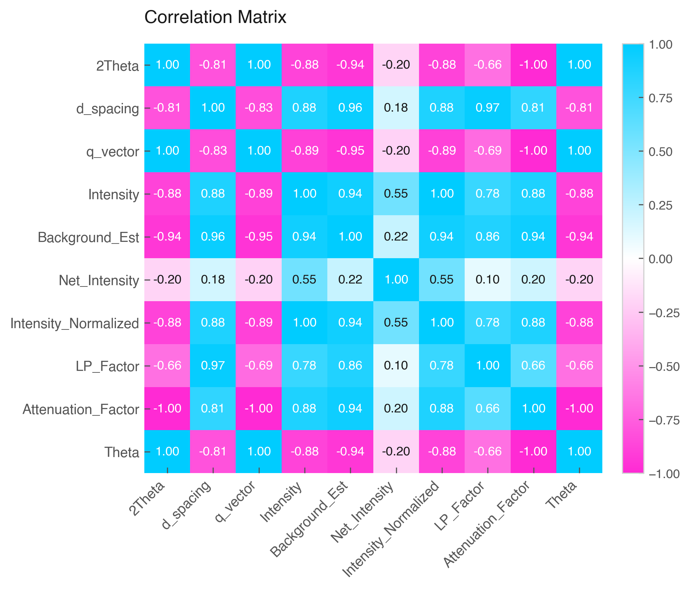

# Correlation Heatmap (`Data.corr_heatmap`)



The `.corr_heatmap()` method calculates Pearson correlation coefficients between numerical variables and presents them in an annotated color-coded heatmap grid.

## Features & Internal Behavior

* **Pearson Matrix Calculation:** Calls `.corr()` internally across all numerical variables.
* **Text Annotations (`annot=True`):** Overlay numeric correlation values inside each cell, automatically swapping text color (black/white) based on background intensity.
* **Diverging Colormap:** Uses a balanced gradient color scale centered at zero ($r \in [-1, 1]$).

## Basic Usage

```python
import elevenone as eo
from elevenone import Data
from elevenone.basic_units import m, s, kg

dataset = Data({
    "Distance": [10, 20, 30, 40] * m,
    "Time": [2, 4, 6, 8] * s,
    "Mass": [1, 2, 1.5, 3] * kg
})

# Generate correlation heatmap
fig, ax = dataset.corr_heatmap(title="Variable Correlation Matrix", annot=True)
```

## Parameter Reference

| Parameter | Type | Default | Description |
| :--- | :--- | :--- | :--- |
| `ax` | `matplotlib.axes.Axes` | `None` | Matplotlib axes object. |
| `figsize` | `tuple` | `(7, 6)` | Figure dimensions. |
| `title` | `str` | `'Correlation Matrix'` | Heatmap title. |
| `cmap` | `Colormap` | `None` | Custom Matplotlib colormap. |
| `annot` | `bool` | `True` | Overlays numeric correlation values inside grid cells. |
| `fmt` | `str` | `".2f"` | String formatting for annotated numbers. |