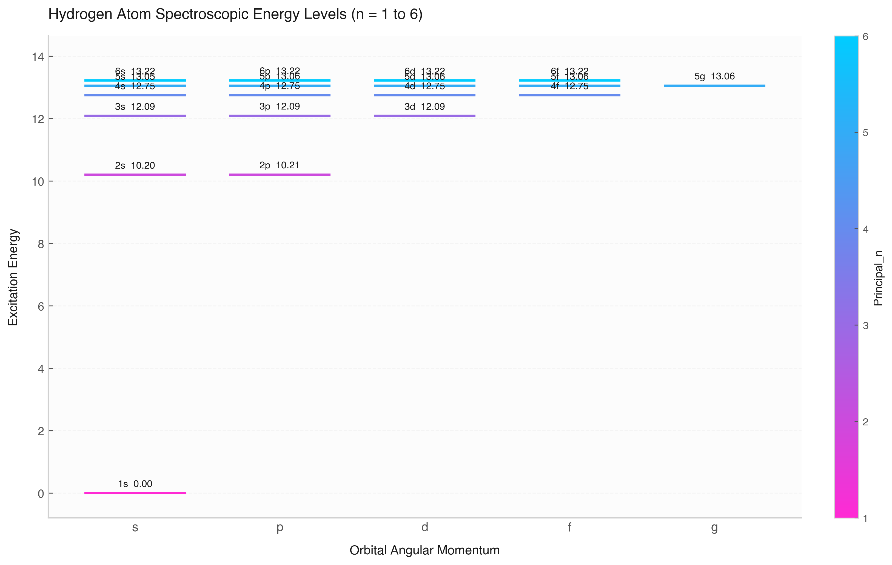

# Energy Levels Diagram (`Data.energy_levels`)



The `.energy_levels()` method draws a quantum-style energy-level diagram where each row in the `Data` object is rendered as a horizontal level. It supports grouping into columns, automatic splitting of degenerate states, uncertainty bands, color-coding, and radiative or non-radiative transition arrows.

## Features & Internal Behavior

* **Automatic Degeneracy Splitting (`split_degenerate=True`):** Detects levels within the same group column whose energies fall within `degeneracy_tol` and places them side by side instead of overlapping them.
* **Column Grouping (`group`):** Organizes states into distinct vertical columns (e.g., by orbital angular momentum $l$, molecular species, or symmetry sector), preserving first-appearance order for text categories or ascending order for numeric groups.
* **Dual Color-Mapping Modes (`color_by`):** Automatically switches between a discrete categorical legend (for text/boolean columns) and a continuous colorbar (for numeric columns), or allows forcing either mode via `discrete=True/False`.
* **Uncertainty Bands (`show_errors=True`):** Renders energy uncertainties as translucent horizontal bands centered on each level whenever non-zero errors are present.
* **Transition Arrows (`transitions`):** Draws directional arrows connecting initial and final row indices `(i, j)` with optional transition labels (such as wavelengths or selection rules).

## Basic Usage

```python
import elevenone as eo
from elevenone import Data
from elevenone.basic_units import eV

# Define hydrogen-like energy states
dataset = Data({
    "n": [1, 2, 2, 3, 3, 3],
    "Orbital": ["s", "s", "p", "s", "p", "d"],
    "State": ["1s", "2s", "2p", "3s", "3p", "3d"],
    "Energy": [-13.6, -3.4, -3.4, -1.51, -1.51, -1.51] * eV
})
dataset.set_error("Energy", [0.0, 0.05, 0.05, 0.08, 0.08, 0.08])

# Plot energy levels grouped by orbital with a transition arrow (3p -> 2s)
fig, ax = dataset.energy_levels(
    energy="Energy",
    group="Orbital",
    color_by="n",
    discrete=True,
    label="State",
    transitions=[(4, 1, "Hα (656 nm)")],
    title="Atomic Energy Levels"
)
```

## Parameter Reference

| Parameter | Type | Default | Description |
| --- | --- | --- | --- |
| `energy` | `str` | *required* | Column name containing energy values (`Quantity` or plain numbers) plotted on the y-axis. |
| `group` | `str` | `None` | Column name used to separate levels into vertical diagram columns. |
| `color_by` | `str` | `None` | Column name used to color levels (triggers a legend for categories or a colorbar for numbers). |
| `label` | `str` | `None` | Column name containing text annotations displayed directly above each level. |
| `ax` | `matplotlib.axes.Axes` | `None` | Existing Matplotlib axes object. |
| `figsize` | `tuple` | `(8, 6)` | Figure dimensions `(width, height)`. |
| `groups` | `list` | `None` | Explicit list defining the subset and display order of `group` columns. |
| `level_width` | `float` | `0.7` | Horizontal width of each energy level line (clamped to $\le$ `spacing`). |
| `spacing` | `float` | `1.0` | Horizontal distance between adjacent group column centers. |
| `linewidth` | `float` | `2.0` | Line thickness of the horizontal energy levels. |
| `color` | `str` | `None` | Uniform level color used when `color_by` is `None` (defaults to theme primary color). |
| `cmap` | `str` or `Colormap` | `None` | Colormap used when `color_by` is in continuous numeric mode. |
| `palette` | `list` or `dict` | `None` | Custom color sequence or `{category: color}` mapping when `color_by` is in discrete mode. |
| `discrete` | `bool` | `None` | Forces discrete legend (`True`) or continuous colorbar (`False`) for `color_by`. |
| `vmin`, `vmax` | `float` | `None` | Lower and upper normalization bounds for continuous `color_by` colormaps. |
| `split_degenerate` | `bool` | `True` | Places degenerate levels in the same column side by side rather than overlapping. |
| `degeneracy_tol` | `float` | `None` | Maximum energy difference to consider levels degenerate (defaults to $10^{-9} \times \text{range}$). |
| `show_values` | `bool` | `False` | Displays the formatted numeric energy value above each level. |
| `value_format` | `str` | `".4g"` | Python format specification string used when `show_values=True`. |
| `show_errors` | `bool` | `True` | Draws a translucent uncertainty band around levels with non-zero errors. |
| `transitions` | `list` | `None` | List of tuples `(i, j)` or `(i, j, "text")` drawing arrows from row index `i` to `j`. |
| `transition_color` | `str` | `None` | Color for transition arrows and labels (defaults to theme secondary color). |
| `legend` | `bool` | `True` | Displays the category legend when `color_by` is discrete. |
| `colorbar` | `bool` | `True` | Displays the colorbar when `color_by` is continuous. |
| `title` | `str` | `None` | Chart title. |
| `xlabel` | `str` | `None` | Custom x-axis label override. |
| `ylabel` | `str` | `None` | Custom y-axis label override. |
| `grid` | `bool` | `True` | Enables horizontal background grid lines. |