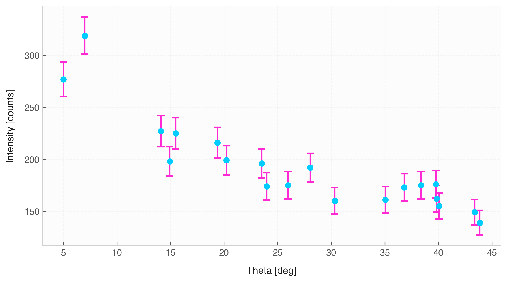

# Errorbar Plot (`Data.errorbar`)



The `.errorbar()` method creates explicit point plots focused on measurement uncertainties. It allows plotting internal $1\sigma$ standard uncertainties or assigning explicit external columns as error values.

## Features & Internal Behavior

* **Automatic Error Retrieval:** Uses the standard $1\sigma$ uncertainty stored in physical `Quantity` objects if external error column names are omitted.
* **Custom Error Column Assignment:** Accepts specific dataset column names for `xerr` or `yerr`.
* **Adaptive Cap & Line Styling:** Dynamically reduces cap size and line thickness for datasets larger than 25 points to ensure visual clarity.
* **Unit Labeling:** Axes automatically adapt to physical units attached to input columns.

## Basic Usage

```python
import elevenone as eo
from elevenone import Data
from elevenone.basic_units import m, N

dataset = Data({
    "Extension": [0.01, 0.02, 0.03, 0.04, 0.05] * m,
    "Force": [2.1, 3.9, 6.2, 7.8, 10.1] * N
})
dataset.set_error("Extension", 0.001)
dataset.set_error("Force", 0.2)

# Plot explicitly with error caps
fig, ax = dataset.errorbar(x="Extension", y="Force", capsize=4, title="Hooke's Law Measurement")
```

## Parameter Reference

| Parameter | Type | Default | Description |
| :--- | :--- | :--- | :--- |
| `x` | `str` | *required* | $x$-axis column name. |
| `y` | `str` | *required* | $y$-axis column name. |
| `yerr` | `str` | `None` | Optional column name to override $y$ uncertainty values. |
| `xerr` | `str` | `None` | Optional column name to override $x$ uncertainty values. |
| `ax` | `matplotlib.axes.Axes` | `None` | Target Matplotlib axes. |
| `figsize` | `tuple` | `(8, 4.5)` | Figure dimensions. |
| `color` | `str` | `None` | Main marker and line color. |
| `ecolor` | `str` | `None` | Color for error bars and end caps. |
| `capsize` | `float` | `4` | Width of error bar end caps. |
| `title` | `str` | `None` | Plot title. |
| `grid` | `bool` | `True` | Toggles grid lines. |