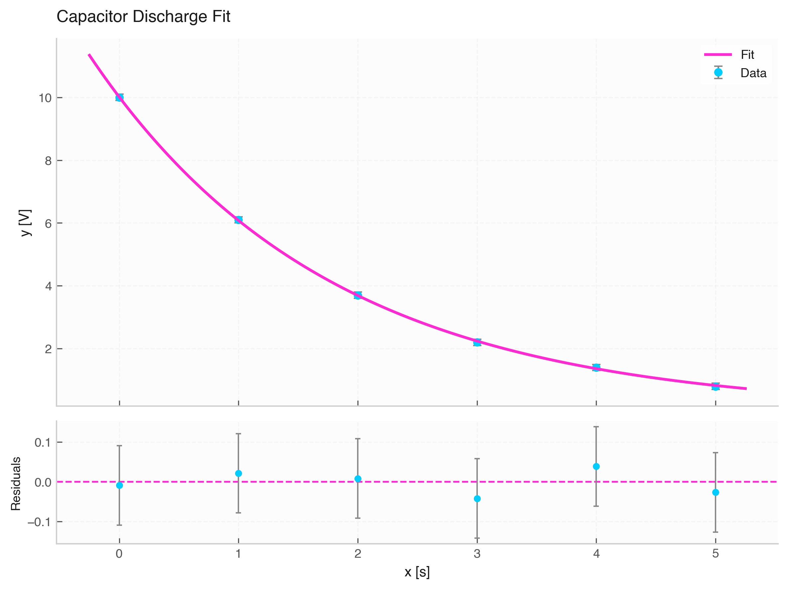

# `fit_exponential` (Exponential Fitting)

The `fit_exponential` function fits exponential growth or decay models ($y = a \cdot e^{b \cdot x}$) to data with uncertainties.



---

## 1. Mathematical Model

$$y(x) = a \cdot e^{b \cdot x}$$

* **`a`**: Amplitude / pre-exponential scale factor.
* **`b`**: Exponential growth rate ($b > 0$) or decay rate ($b < 0$).

---

## 2. Inferred Parameter Units

Because exponents must be dimensionless ($[b \cdot x] = 1$):

* **`a` (Amplitude)**: $[y]$
* **`b` (Rate)**: $[x]^{-1}$

---

## 3. Function Signature & Parameters

```python
fit_exponential(
    data: Optional[Data] = None,
    x: Optional[Union[str, np.ndarray, Quantity]] = None,
    y: Optional[Union[str, np.ndarray, Quantity]] = None,
    xerr: Optional[Union[str, np.ndarray, Quantity, float]] = None,
    yerr: Optional[Union[str, np.ndarray, Quantity, float]] = None,
    p0: Optional[List[float]] = None
) -> FitResult
```

---

## 4. Usage Example

```python
from elevenone import *
from elevenone.fitting import fit_exponential

# Capacitor discharge data
data = Data({
    "Time": [0.0, 1.0, 2.0, 3.0, 4.0, 5.0] * s,
    "Voltage": [10.0, 6.1, 3.7, 2.2, 1.4, 0.8] * V
})
data.set_error("Voltage", 0.1)

# Exponential fit with initial guess p0=[a, b]
res = fit_exponential(data, x="Time", y="Voltage", p0=[10.0, -0.5])

# Compute decay time constant tau = -1 / b
b_param = res.params["b"]
tau = -1.0 / b_param.value

print(f"Decay time constant (tau): {tau:.2f} s")
fig, ax = res.plot(title="Capacitor Discharge Fit")
```