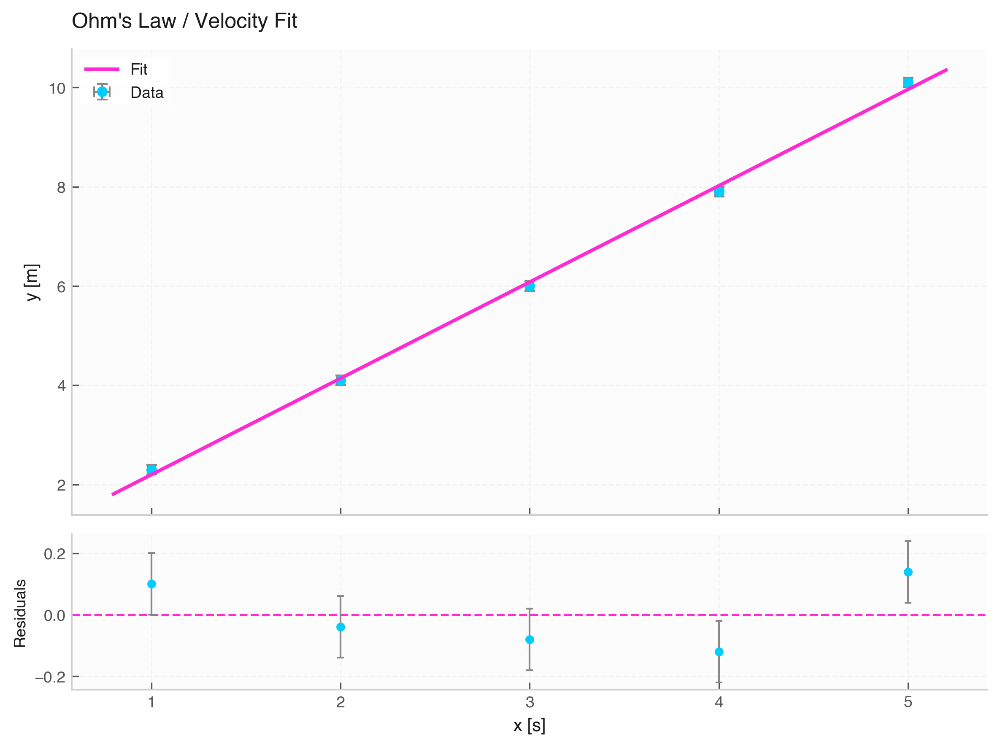

# `fit_linear` (Linear Fitting)

The `fit_linear` function performs linear regression ($y = m \cdot x + b$) on data with optional measurement errors in both $x$ and $y$.



---

## 1. Mathematical Model

$$y(x) = m \cdot x + b$$

* **`m`**: Slope of the linear relationship.
* **`b`**: $y$-intercept.

---

## 2. Inferred Parameter Units

Units are automatically computed from the input quantities:

* **`m` (Slope)**: $[y] / [x]$
* **`b` (Intercept)**: $[y]$

---

## 3. Function Signature & Parameters

```python
fit_linear(
    data: Optional[Data] = None,
    x: Optional[Union[str, np.ndarray, Quantity]] = None,
    y: Optional[Union[str, np.ndarray, Quantity]] = None,
    xerr: Optional[Union[str, np.ndarray, Quantity, float]] = None,
    yerr: Optional[Union[str, np.ndarray, Quantity, float]] = None
) -> FitResult
```

---

## 4. Usage Example

```python
from elevenone import *
from elevenone.fitting import fit_linear

# Dataset with units
data = Data({
    "Time": [1.0, 2.0, 3.0, 4.0, 5.0] * s,
    "Position": [2.3, 4.1, 6.0, 7.9, 10.1] * m
})

# Assign uncertainties
data.set_error("Time", 0.02)
data.set_error("Position", 0.1)

# Perform linear fit
res = fit_linear(data, x="Time", y="Position")

# Access parameter quantities
slope = res.params["m"]        # e.g., 1.95 ± 0.04 m·s⁻¹
intercept = res.params["b"]    # e.g., 0.31 ± 0.11 m

print(res.summary())
fig, ax = res.plot(title="Ohm's Law / Velocity Fit")
```