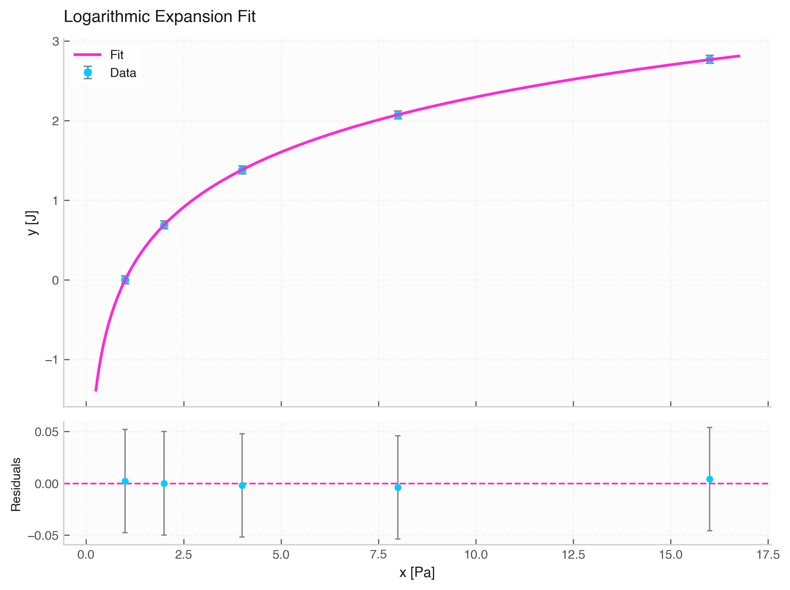

# `fit_logarithmic` (Logarithmic Fitting)

The `fit_logarithmic` function fits logarithmic curves ($y = a \cdot \ln(x) + b$) to experimental data.



---

## 1. Mathematical Model

$$y(x) = a \cdot \ln(x) + b$$

* **`a`**: Logarithmic slope coefficient.
* **`b`**: Constant offset / intercept.

---

## 2. Inferred Parameter Units

Because $\ln(x)$ is evaluated on numerical magnitude:

* **`a`**: $[y]$
* **`b`**: $[y]$

---

## 3. Function Signature & Parameters

```python
fit_logarithmic(
    data: Optional[Data] = None,
    x: Optional[Union[str, np.ndarray, Quantity]] = None,
    y: Optional[Union[str, np.ndarray, Quantity]] = None,
    xerr: Optional[Union[str, np.ndarray, Quantity, float]] = None,
    yerr: Optional[Union[str, np.ndarray, Quantity, float]] = None,
    p0: Optional[List[float]] = None
) -> FitResult
```

---

## 4. Usage Example

```python
from elevenone import *
from elevenone.fitting import fit_logarithmic

# Isothermal expansion / work data
data = Data({
    "Pressure": [1.0, 2.0, 4.0, 8.0, 16.0] * Pa,
    "Work": [0.0, 0.69, 1.38, 2.07, 2.77] * J
})
data.set_error("Work", 0.05)

# Fit logarithmic model
res = fit_logarithmic(data, x="Pressure", y="Work")

print(res.summary())
fig, ax = res.plot(title="Logarithmic Expansion Fit")
```