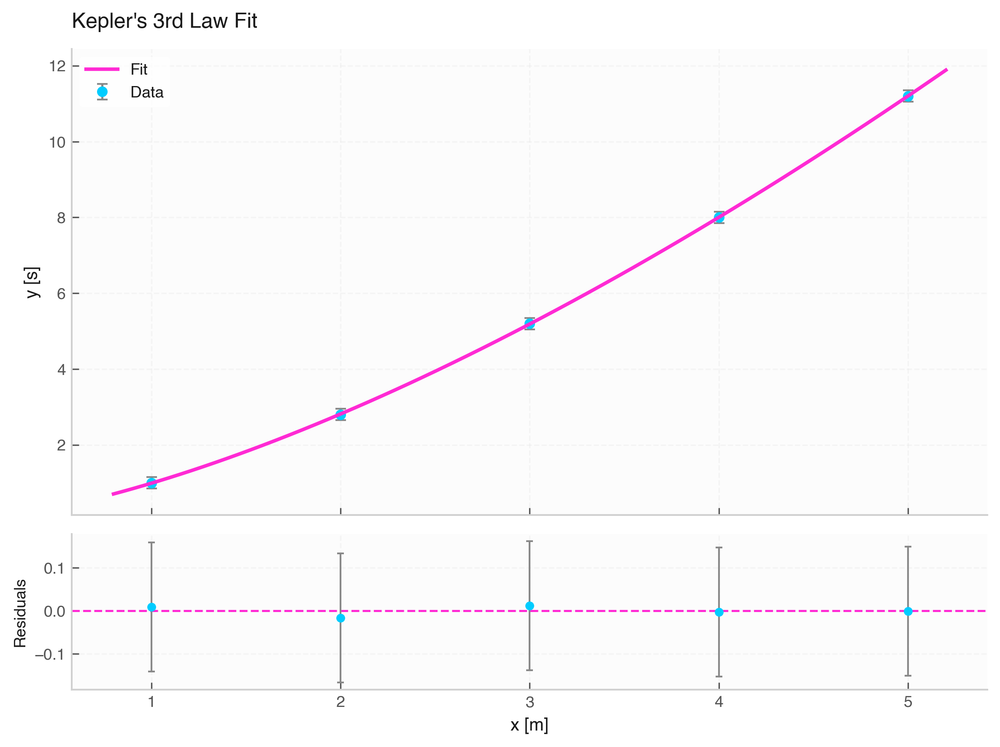

# `fit_power` (Power Law Fitting)

The `fit_power` function fits power-law relationships ($y = a \cdot x^b$) to experimental data with errors in both axes.



---

## 1. Mathematical Model

$$y(x) = a \cdot x^b$$

* **`a`**: Proportionality scale constant.
* **`b`**: Power-law exponent.

---

## 2. Inferred Parameter Units

* **`a` (Scale Factor)**: $[y]$
* **`b` (Exponent)**: Dimensionless

---

## 3. Function Signature & Parameters

```python
fit_power(
    data: Optional[Data] = None,
    x: Optional[Union[str, np.ndarray, Quantity]] = None,
    y: Optional[Union[str, np.ndarray, Quantity]] = None,
    xerr: Optional[Union[str, np.ndarray, Quantity, float]] = None,
    yerr: Optional[Union[str, np.ndarray, Quantity, float]] = None,
    p0: Optional[List[float]] = None
) -> FitResult
```

---

## 4. Usage Example

```python
from elevenone import *
from elevenone.fitting import fit_power

# Kepler's 3rd Law: Orbital Period vs Semi-major Axis (T ~ a^(1.5))
data = Data({
    "Radius": [1.0, 2.0, 3.0, 4.0, 5.0] * m,
    "Period": [1.0, 2.8, 5.2, 8.0, 11.2] * s
})
data.set_error("Period", 0.15)

# Fit power law
res = fit_power(data, x="Radius", y="Period", p0=[1.0, 1.5])

exponent = res.params["b"]  # Expected close to 1.5
print(f"Power Exponent: {exponent.value:.3f} +/- {exponent.error:.3f}")

fig, ax = res.plot(title="Kepler's 3rd Law Fit")
```