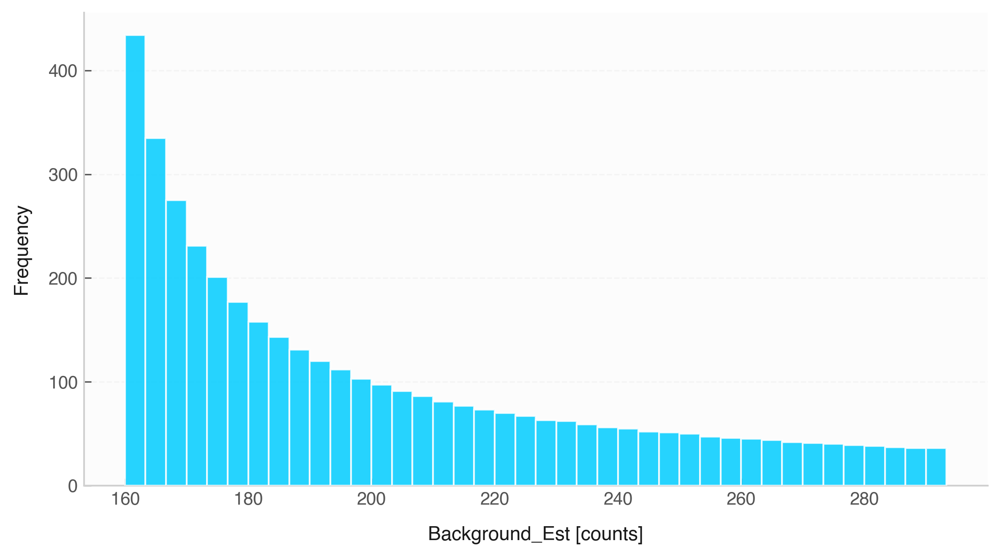

# Histogram (`Data.hist`)



The `.hist()` method renders univariate frequency distribution histograms for numerical variables, complete with clean bin edges and unit-aware labels.

## Features & Internal Behavior

* **Frequency Counting:** Bins continuous observations into customizable discrete intervals.
* **Automated Y-Axis Labeling:** Sets the $y$-axis title to `"Frequency"` automatically.
* **Unit Extraction:** Places physical unit notation in the $x$-axis label (`Column [Unit]`).

## Basic Usage

```python
import numpy as np
import elevenone as eo
from elevenone import Data
from elevenone.basic_units import ms

np.random.seed(42)
dataset = Data({
    "Response_Time": np.random.normal(loc=150, scale=15, size=200) * ms
})

# Generate histogram
fig, ax = dataset.hist(column="Response_Time", bins=15, title="Sensor Response Time Distribution")
```

## Parameter Reference

| Parameter | Type | Default | Description |
| :--- | :--- | :--- | :--- |
| `column` | `str` | *required* | Numerical variable column name to plot. |
| `bins` | `int` or `sequence` | `12` | Number of histogram bins or bin edge array. |
| `ax` | `matplotlib.axes.Axes` | `None` | Existing Matplotlib axes. |
| `figsize` | `tuple` | `(8, 4.5)` | Figure dimensions. |
| `color` | `str` | `None` | Custom bin fill color. |
| `title` | `str` | `None` | Chart title. |
| `grid` | `bool` | `True` | Enables background horizontal grid lines. |