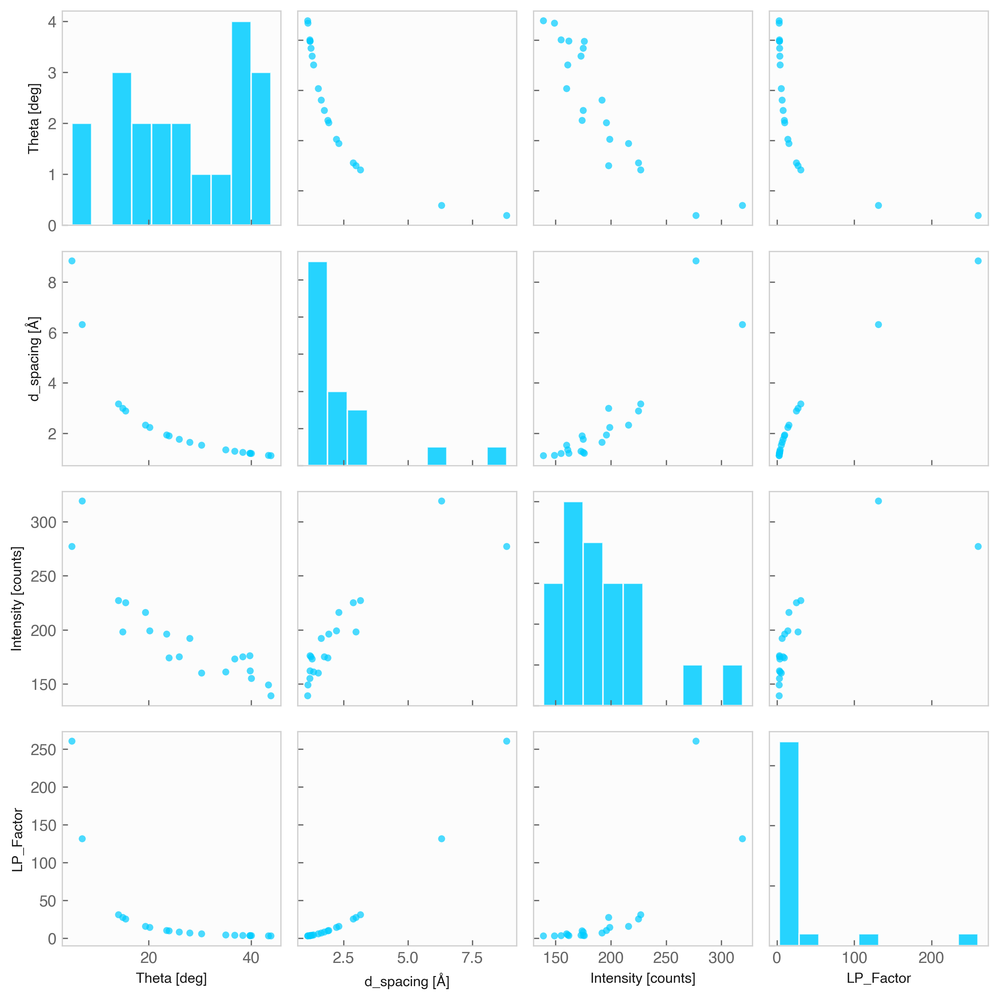

# Pair Plot (`Data.pairplot`)



The `.pairplot()` method builds an $n \times n$ matrix of subplots showing pairwise bivariate scatter plots alongside univariate distribution histograms along the diagonal.

## Features & Internal Behavior

* **Diagonal Histograms:** Displays univariate frequency distributions for each variable along the diagonal ($i = j$).
* **Off-Diagonal Scatter Plots:** Displays bivariate scatter plots for variable pairs ($i \neq j$).
* **Automatic Scaling:** Adapts point sizes based on dataset sample length to avoid overcrowding matrix cells.

## Basic Usage

```python
import numpy as np
import elevenone as eo
from elevenone import Data
from elevenone.basic_units import V, A, degC

dataset = Data({
    "Voltage": [1.0, 2.0, 3.0, 4.0, 5.0] * V,
    "Current": [0.1, 0.2, 0.3, 0.45, 0.5] * A,
    "Temperature": [22.0, 23.5, 25.0, 27.1, 30.0] * degC
})

# Generate full pairwise comparison matrix
fig, axes = dataset.pairplot(figsize=(8, 8))
```

## Parameter Reference

| Parameter | Type | Default | Description |
| :--- | :--- | :--- | :--- |
| `columns` | `list` | `None` | Subset of numerical column names to include (defaults to all numeric columns). |
| `figsize` | `tuple` | `(9, 9)` | Total figure dimensions `(width, height)`. |