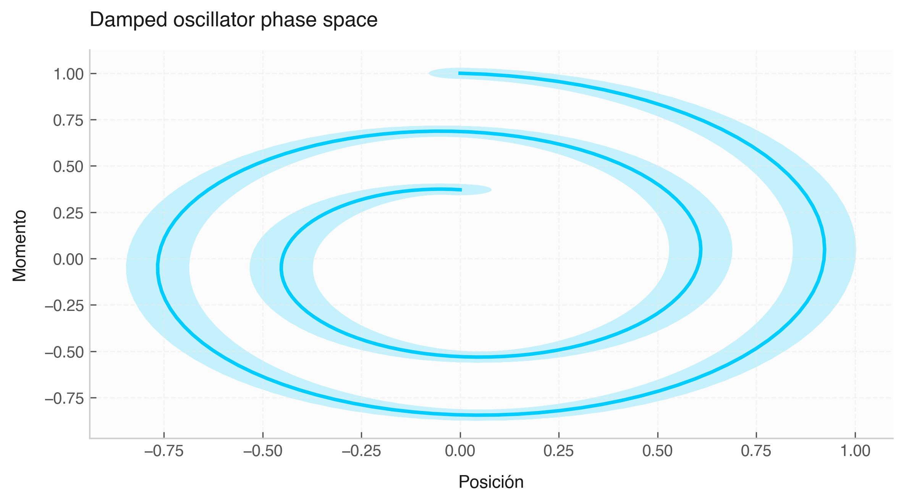

# Phase Space Plot (`Data.phase_space`)



The `.phase_space()` method plots a dynamical system trajectory (such as position versus momentum) while preserving the sequential order of the data points. When uncertainties are present, it renders a continuous error halo along the entire path.

## Features & Internal Behavior

* **Trajectory Order Preservation:** Plots points in their exact array sequence without sorting along the x-axis, allowing closed orbits, spirals, and loops to render accurately.
* **Continuous Error Halo (`show_errors=True`):** Computes the exact geometric envelope (Minkowski sum of consecutive error ellipses) around the trajectory in data coordinates, widening and narrowing dynamically with the uncertainty at each point.
* **Dynamic Marker Sizing:** Automatically displays point markers for trajectories with up to 50 points and hides them on denser trajectories for a cleaner curve.
* **Unit Label Extraction:** Axis labels are automatically formatted with column names and active unit symbols.

## Basic Usage

```python
import numpy as np
import elevenone as eo
from elevenone import Data
from elevenone.basic_units import m, kg, s

t = np.linspace(0, 4 * np.pi, 100)
dataset = Data({
    "Position": np.cos(t) * np.exp(-0.1 * t) * m,
    "Momentum": -np.sin(t) * np.exp(-0.1 * t) * (kg * m / s)
})
dataset.set_error("Position", 0.04)
dataset.set_error("Momentum", 0.04)

# Generate phase space trajectory with a 1-sigma uncertainty halo
fig, ax = dataset.phase_space(x="Position", p="Momentum", title="Damped Harmonic Oscillator")

```

## Parameter Reference

| Parameter | Type | Default | Description |
| --- | --- | --- | --- |
| `x` | `str` | *required* | Horizontal axis variable column name (e.g., generalized coordinate). |
| `p` | `str` | *required* | Vertical axis variable column name (e.g., conjugate momentum). |
| `ax` | `matplotlib.axes.Axes` | `None` | Existing Matplotlib axes object. |
| `figsize` | `tuple` | `(8, 4.5)` | Figure dimensions `(width, height)`. |
| `color` | `str` | `None` | Trajectory line and halo color. |
| `linestyle` | `str` | `'-'` | Matplotlib line style. |
| `linewidth` | `float` | `2.2` | Trajectory line width. |
| `show_errors` | `bool` | `True` | Draws a shaded uncertainty ribbon around the trajectory when errors exist. |
| `error_alpha` | `float` | `0.22` | Opacity of the uncertainty halo (0.0 to 1.0). |
| `error_scale` | `float` | `1.0` | Multiplier applied to uncertainties (e.g., `2.0` for a $2\sigma$ halo). |
| `marker` | `str` | `'o'` | Marker shape for trajectory vertices. |
| `markersize` | `float` | `None` | Marker size (defaults to `3` if samples $\le 50$, otherwise `0`). |
| `title` | `str` | `None` | Chart title. |
| `xlabel` | `str` | `None` | Custom x-axis label override. |
| `ylabel` | `str` | `None` | Custom y-axis label override. |
| `grid` | `bool` | `True` | Enables background grid lines. |

