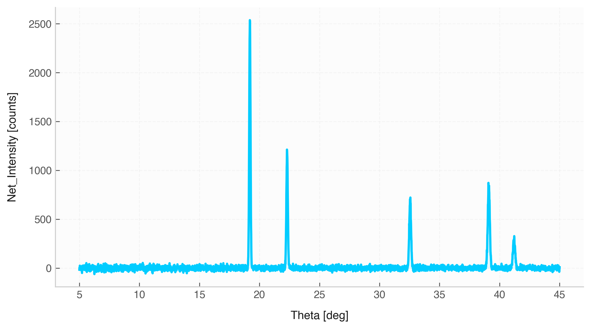

# Line Plot (`Data.plot`)



The `.plot()` method generates connected line charts for numerical variables in a `Data` container. It automatically sorts $x$-values, displays semi-transparent area fills, formats axis labels with physical units, and includes uncertainty error bars when appropriate.

## Features & Internal Behavior

* **Automatic Sorting:** Sorts data points along the $x$-axis (`sort_x=True` by default) to ensure continuous, non-overlapping line plots.
* **Smart Error Bar Management:** Displays $1\sigma$ error bars for datasets with 25 or fewer points to prevent visual overcrowding.
* **Automatic Unit Labels:** Extracts physical unit symbols for both variables and appends them to axis titles (`Column [Unit]`).
* **Semi-Transparent Fill:** Highlights trends using a subtle translucent background under the primary curve.

## Basic Usage

```python
import elevenone as eo
from elevenone import Data
from elevenone.basic_units import s, m

dataset = Data({
    "Time": [0.0, 1.0, 2.0, 3.0, 4.0, 5.0] * s,
    "Position": [0.0, 2.1, 8.2, 17.9, 31.8, 50.1] * m
})
dataset.set_error("Position", 0.8)

# Generate line plot
fig, ax = dataset.plot(x="Time", y="Position", title="Position vs Time")
```

## Parameter Reference

| Parameter | Type | Default | Description |
| :--- | :--- | :--- | :--- |
| `x` | `str` | *required* | Column name for the independent variable. |
| `y` | `str` | *required* | Column name for the dependent variable. |
| `ax` | `matplotlib.axes.Axes` | `None` | Existing Matplotlib axes object. |
| `figsize` | `tuple` | `(8, 4.5)` | Figure dimensions `(width, height)`. |
| `color` | `str` | `None` | Custom line color hex or name. |
| `linestyle` | `str` | `'-'` | Matplotlib line style (`'-'`, `'--'`, `':'`). |
| `linewidth` | `float` | `2.2` | Line width. |
| `marker` | `str` | `'o'` | Point marker symbol. |
| `markersize` | `bool` or `float` | `True` | Automatically scales marker size based on sample length. |
| `fill_area` | `bool` | `True` | Fills translucent color below the line. |
| `sort_x` | `bool` | `True` | Sorts data points by $x$-axis values prior to plotting. |
| `title` | `str` | `None` | Custom chart title. |
| `grid` | `bool` | `True` | Toggles background grid lines. |