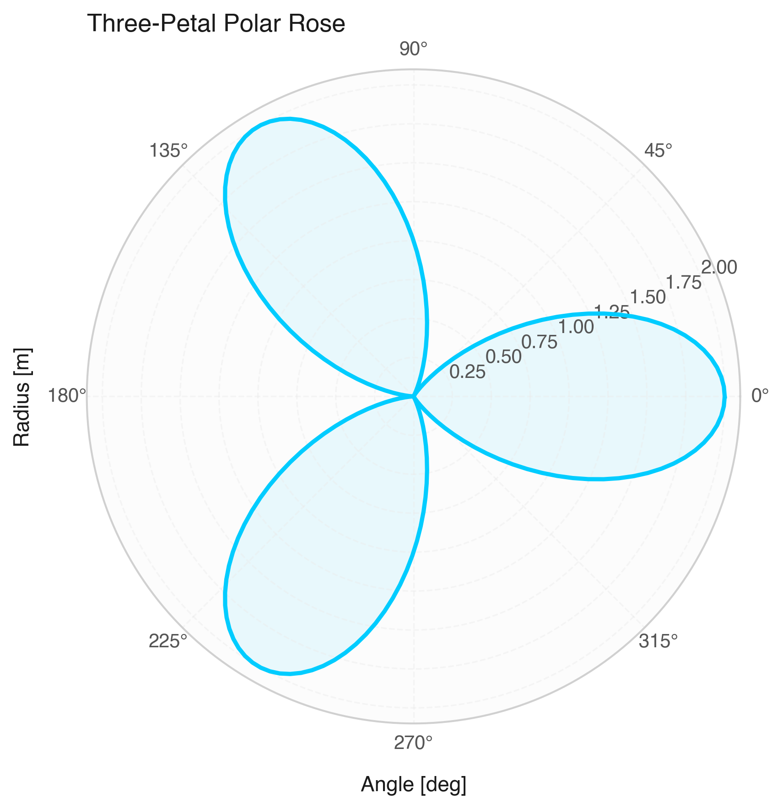
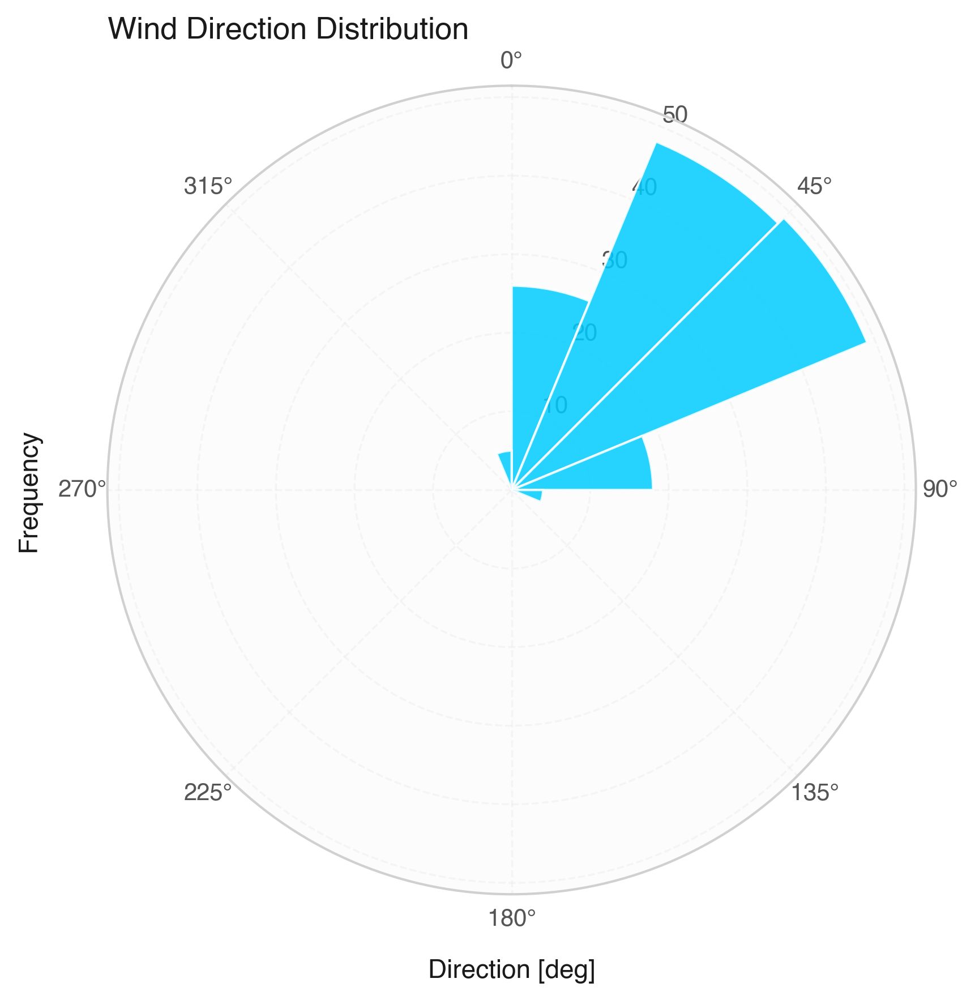

# Polar Plot (`Data.polar_plot`)




The `.polar_plot()` method creates circular visualizations where the angular coordinate (`theta`) is mapped around a circle and the radial coordinate (`r`) extends outward from the center. It supports line trajectories, scatter points, radial bars, and angular histograms (rose diagrams).

## Features & Internal Behavior

* **Automatic Angle Detection & Conversion:** If `theta` is a `Quantity` with angular units (`deg`, `rad`, etc.), it is automatically converted to radians internally while formatting tick labels in degrees (or multiples of $\pi$ for radians). Plain numeric arrays are inferred as degrees if any $|value| > 2\pi$, or radians otherwise (overridable via `degrees=True/False`).
* **Circular Histogram / Rose Diagram (`r=None`):** Omitting `r` automatically computes a binned circular frequency histogram of `theta` across `[0, 2π)` with `bins` angular sectors.
* **Multiple Plot Geometries (`kind`):** Supports continuous trajectories (`'line'`, with optional loop closure via `close=True` and area shading via `fill_area=True`), discrete points (`'scatter'`), and radial bars (`'bar'`).
* **Compass & Orientation Controls:** Customize the zero-angle origin (`zero_location='E'`, `'N'`, `'W'`, `'S'`, etc.) and rotation direction (`clockwise=True/False`) to match mathematical or navigational conventions.
* **Angular & Radial Uncertainties (`show_errors=True`):** Renders error bars along both $\theta$ and $r$ when uncertainties are present (for datasets up to 25 points).

## Basic Usage

### 1. Polar Curve (`r` provided)

```python
import numpy as np
from elevenone import *

theta = np.linspace(0, 360, 200) * deg
r = (1 + np.cos(3 * np.deg2rad(theta.value))) * m

dataset = Data({
    "Angle": theta,
    "Radius": r
})

# Plot a closed polar rose curve with shaded interior
dataset.polar_plot(
    theta="Angle",
    r="Radius",
    kind="line",
    close=True,
    fill_area=True,
    title="Three-Petal Polar Rose"
)
```

### 2. Circular Histogram / Rose Diagram (`r=None`)

```python
import numpy as np
from elevenone import *

# Wind direction measurements in degrees
np.random.seed(42)
wind_dir = Data({
    "Direction": np.random.normal(loc=45, scale=25, size=150) * deg
})

# Omit 'r' to generate a 16-sector compass rose histogram
wind_dir.polar_plot(
    theta="Direction",
    bins=16,
    zero_location="N",
    clockwise=True,
    title="Wind Direction Distribution"
)
```

## Parameter Reference

| Parameter | Type | Default | Description |
| :--- | :--- | :---: | :--- |
| `theta` | `str` | *required* | Angular column name (`Quantity` with angular unit or plain numbers). |
| `r` | `str` | `None` | Radial column name. When `None`, renders an angular frequency histogram (rose diagram). |
| `ax` | `matplotlib.axes.Axes` | `None` | Existing Matplotlib polar axes (`projection='polar'`). |
| `figsize` | `tuple` | `(6, 6)` | Figure dimensions `(width, height)`. |
| `color` | `str` | `None` | Primary color for lines, markers, or bars (defaults to theme primary color). |
| `kind` | `str` | `'line'` | Chart geometry when `r` is given: `'line'`, `'scatter'`, or `'bar'`. |
| `linestyle` | `str` | `'-'` | Matplotlib line style (used when `kind='line'`). |
| `linewidth` | `float` | `2.2` | Line thickness (used when `kind='line'`). |
| `marker` | `str` | `'o'` | Marker shape for vertices (used when `kind='line'` or `'scatter'`). |
| `markersize` | `float` | `None` | Marker size (defaults to `4.5` if samples $\le 25$, otherwise `0`). |
| `fill_area` | `bool` | `False` | Shades the area enclosed by the polar curve (when `kind='line'`). |
| `close` | `bool` | `False` | Connects the last data point back to the first to close the curve (`kind='line'`). |
| `sort_theta` | `bool` | `False` | Sorts points by ascending `theta` instead of preserving array sequence order. |
| `show_errors` | `bool` | `True` | Draws angular and radial error bars when uncertainties exist ($\le 25$ points). |
| `degrees` | `bool` | `None` | Explicitly treats plain numeric `theta` values as degrees (`True`) or radians (`False`). |
| `bins` | `int` | `24` | Number of angular sectors when `r=None` (circular histogram mode). |
| `zero_location` | `str` | `'E'` | Position of $\theta = 0$ on the circle (`'E'`, `'N'`, `'W'`, `'S'`, `'NE'`, `'NW'`, `'SE'`, `'SW'`). |
| `clockwise` | `bool` | `False` | Sets increasing angles to run clockwise (`True`) or counter-clockwise (`False`). |
| `rmin`, `rmax` | `float` | `None` | Minimum and maximum radial axis limits. |
| `title` | `str` | `None` | Chart title. |
| `thetalabel` | `str` | `None` | Custom angular axis label override. |
| `rlabel` | `str` | `None` | Custom radial axis label override. |
| `grid` | `bool` | `True` | Enables circular and radial grid lines. |