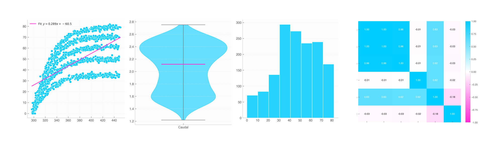

# Quick Start Guide

This guide provides a quick overview of how to work with **ElevenOne**. You will learn how to create physical quantities with uncertainties, load datasets automatically, perform dimensional operations, plot scientific data, and generate reports.



---

## 1. Physical Quantities & Uncertainty Propagation

In ElevenOne, numbers can carry units and standard measurement uncertainties ($1\sigma$). All mathematical calculations automatically track units and propagate errors.

```python
import elevenone as eo
from elevenone.basic_units import m, s, kg

# Define quantities with values, units, and uncertainties (1σ)
distance = 100 * m              # 100 meters (error = 0)
time = eo.Quantity(9.58, s, 0.05)  # 9.58 ± 0.05 s

# Automatic unit division & uncertainty propagation
velocity = distance / time

print("Distance:", distance)
print("Time:    ", time)
print("Velocity:", velocity)
```

**Output:**
```text
Distance: 100 m
Time:     (9.58 ± 0.05) s
Velocity: (10.438413361169102 ± 0.05447998634590393) m·s⁻¹
```

---

## 2. Unit Conversions

Converting between compatible units handles scaling factors and error bounds seamlessly:

```python
from elevenone.basic_units import km, h

# Convert m/s to km/h
v_kmh = velocity.convert_to(km / h)
print("Velocity (km/h):", v_kmh)
```

---

## 3. Intelligent Data Loading (`load_data`)

ElevenOne loads CSV or Excel files, automatically detecting physical units in column headers and pairing uncertainty columns (e.g., `_err`, `_unc`, `_sigma`).

```python
import elevenone as eo

# Loads file and automatically pairs 'time_err' with 'time' 
# and recognizes units like 'Voltage (V)'
df = eo.load_data("experiment_results.csv")

# Print dataset structure
print(df)
```

---

## 4. Manipulating Data & Setting Errors

You can create or modify `Data` objects directly, run queries, or assign uncertainties on the fly:

```python
from elevenone import Data
from elevenone.basic_units import V, A, Ohm

# Create Data manually
dataset = Data({
    "Voltage": [1.5, 3.0, 4.5, 6.0] * V,
    "Current": [0.15, 0.29, 0.46, 0.61] * A
})

# Assign uncertainties
dataset.set_error("Voltage", 0.05)   # ± 0.05 V for all rows
dataset.set_error("Current", 0.01)   # ± 0.01 A for all rows

# Derive new columns — units and errors propagate automatically!
dataset["Resistance"] = dataset["Voltage"] / dataset["Current"]

# Filter data using boolean queries
high_voltage = dataset.query("Voltage > 3.0")
```

---

## 5. Automated Publication-Ready Plotting

Plot functions automatically render $1\sigma$ error bars and include unit symbols on labels:

```python
# Scatter plot with linear fit and automatic error bars
fig, ax = dataset.scatter(
    x="Current", 
    y="Voltage", 
    fit=True, 
    title="Ohm's Law Verification"
)
```

---

## 6. One-Line Scientific Report Generation

Generate a complete 11-section analytical report with tables, summary statistics, and embedded plots in HTML or PDF format:

```python
# Generate an HTML report
dataset.generate_report("experiment_report.html", format_type="html")

# Generate a PDF report (requires ReportLab)
dataset.generate_report("experiment_report.pdf", format_type="pdf")
```