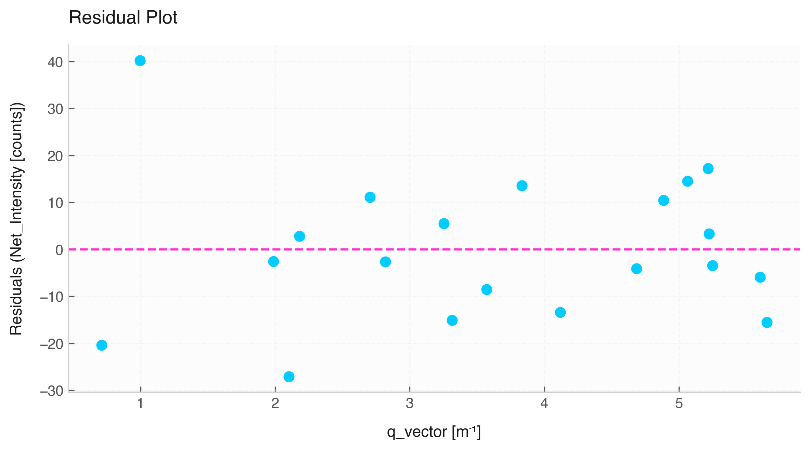

# Residual Plot (`Data.residual_plot`)



The `.residual_plot()` method evaluates linear fits between two numerical variables by plotting the differences (residuals $y - \hat{y}$) against the independent variable $x$.

## Features & Internal Behavior

* **Linear Regression Fitting:** Computes an internal linear fit ($y = mx + b$) and calculates predicted values $\hat{y}$.
* **Zero Baseline Reference:** Includes a dashed horizontal reference line at $y = 0$.
* **Residual Inspection:** Helps spot non-linear patterns, heteroscedasticity, or systematic experimental deviations.

## Basic Usage

```python
import elevenone as eo
from elevenone import Data
from elevenone.basic_units import s, m

dataset = Data({
    "Time": [1.0, 2.0, 3.0, 4.0, 5.0] * s,
    "Distance": [2.2, 3.9, 6.1, 8.2, 9.8] * m
})

# Generate residual plot
fig, ax = dataset.residual_plot(x="Time", y="Distance", title="Linear Fit Residuals")
```

## Parameter Reference

| Parameter | Type | Default | Description |
| :--- | :--- | :--- | :--- |
| `x` | `str` | *required* | Independent variable column name. |
| `y` | `str` | *required* | Dependent variable column name. |
| `ax` | `matplotlib.axes.Axes` | `None` | Matplotlib axes object. |
| `figsize` | `tuple` | `(8, 4.5)` | Figure size. |
| `title` | `str` | `'Residual Plot'` | Custom title. |
| `grid` | `bool` | `True` | Enables grid lines. |