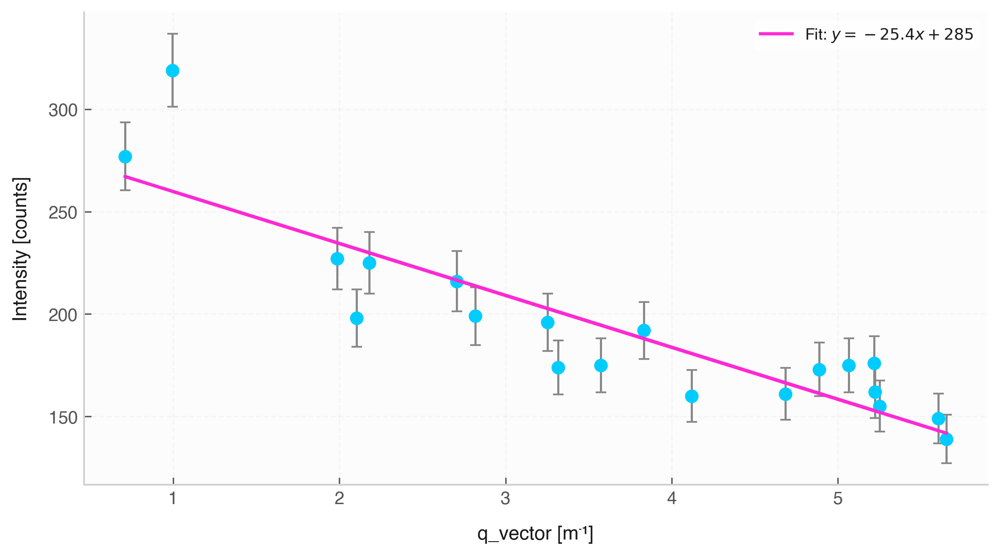

# Scatter Plot (`Data.scatter`)



The `.scatter()` method visualizes bivariate relationships between data variables. It integrates $1\sigma$ measurement error bars, unit-aware axis labelling, point size adjustments for dense datasets, and optional linear trendline fitting.

## Features & Internal Behavior

* **Uncertainty Overlay:** Draws vertical and horizontal error bars ($1\sigma$) automatically for datasets containing up to 25 data points.
* **Dynamic Point Scaling:** Automatically reduces point marker size for datasets with more than 25 observations to prevent clutter.
* **Linear Fitting (`fit=True`):** Computes a 1st-degree polynomial fit ($y = mx + b$), plots the regression line, and displays the equation inside the legend.
* **Unit Label Extraction:** Axis labels are automatically formatted with column names and unit symbols.

## Basic Usage

```python
import elevenone as eo
from elevenone import Data
from elevenone.basic_units import V, A

dataset = Data({
    "Current": [0.10, 0.19, 0.31, 0.40, 0.52] * A,
    "Voltage": [1.02, 1.98, 3.05, 4.01, 5.15] * V
})
dataset.set_error("Voltage", 0.08)

# Generate scatter plot with linear regression line
fig, ax = dataset.scatter(x="Current", y="Voltage", fit=True, title="Ohm's Law Verification")
```

## Parameter Reference

| Parameter | Type | Default | Description |
| :--- | :--- | :--- | :--- |
| `x` | `str` | *required* | Independent variable column name. |
| `y` | `str` | *required* | Dependent variable column name. |
| `ax` | `matplotlib.axes.Axes` | `None` | Existing Matplotlib axes object. |
| `figsize` | `tuple` | `(8, 4.5)` | Figure dimensions `(width, height)`. |
| `color` | `str` | `None` | Marker fill color. |
| `s` | `float` | `45` | Marker size (auto-scaled down if samples > 25). |
| `alpha` | `float` | `1` | Marker transparency (0.0 to 1.0). |
| `marker` | `str` | `'o'` | Matplotlib scatter marker shape. |
| `fit` | `bool` | `False` | Overlays linear regression line and fit equation. |
| `title` | `str` | `None` | Chart title. |
| `grid` | `bool` | `True` | Enables background grid lines. |