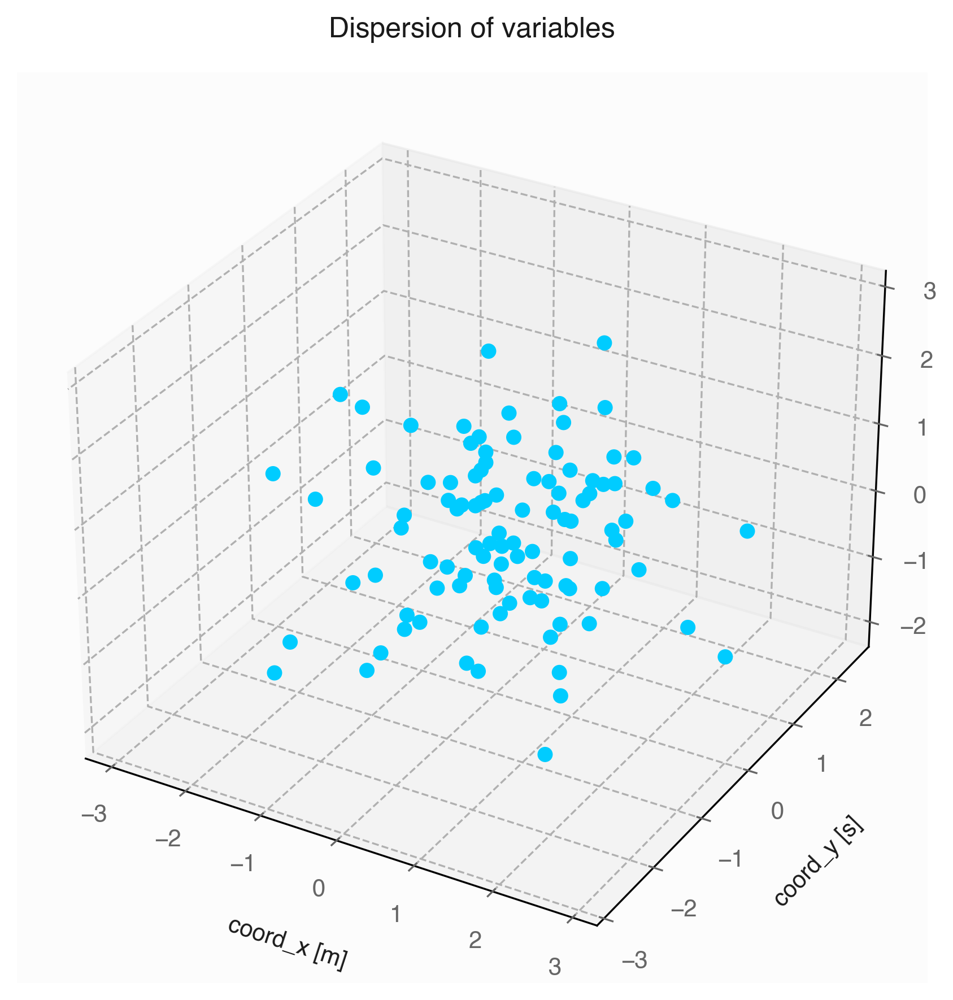

# 3D Scatter Plot (`Data.scatter_3d`)



The `.scatter_3d()` method visualizes trivariate relationships across three `Data` columns in a 3D projection, automatically formatting axis labels with their corresponding physical units.

## Features & Internal Behavior

* **Automatic 3D Projection:** Initializes a Matplotlib `3d` subplot styled with the active ElevenOne theme (`facecolor`, `figure_facecolor`, and typography) when no `ax` is passed.
* **Unit Label Extraction:** Automatically appends unit symbols to the `x`, `y`, and `z` axis labels based on the active unit scheme.
* **Custom Axes Support:** Accepts an existing `Axes3D` instance via `ax` for multi-dataset overlays or subplot grids.

## Basic Usage

```python
import numpy as np
import elevenone as eo
from elevenone import Data
from elevenone.basic_units import m, s

t = np.linspace(0, 10, 60)
dataset = Data({
    "X": np.cos(t) * m,
    "Y": np.sin(t) * m,
    "Time": t * s
})

# Generate 3D scatter plot
fig, ax = dataset.scatter_3d(x="X", y="Y", z="Time", title="Helical Trajectory")

```

## Parameter Reference

| Parameter | Type | Default | Description |
| --- | --- | --- | --- |
| `x` | `str` | *required* | X-axis variable column name. |
| `y` | `str` | *required* | Y-axis variable column name. |
| `z` | `str` | *required* | Z-axis variable column name. |
| `ax` | `Axes3D` | `None` | Existing Matplotlib 3D axes object. |
| `figsize` | `tuple` | `(8, 6)` | Figure dimensions `(width, height)`. |
| `color` | `str` | `None` | Marker fill color (defaults to active style primary color). |
| `s` | `float` | `30` | Marker size in points squared. |
| `alpha` | `float` | `1` | Marker transparency (0.0 to 1.0). |
| `marker` | `str` | `'o'` | Matplotlib scatter marker shape. |
| `title` | `str` | `None` | Chart title. |
| `xlabel` | `str` | `None` | Custom x-axis label override. |
| `ylabel` | `str` | `None` | Custom y-axis label override. |
| `zlabel` | `str` | `None` | Custom z-axis label override. |
| `grid` | `bool` | `True` | Enables 3D background grid planes. |
