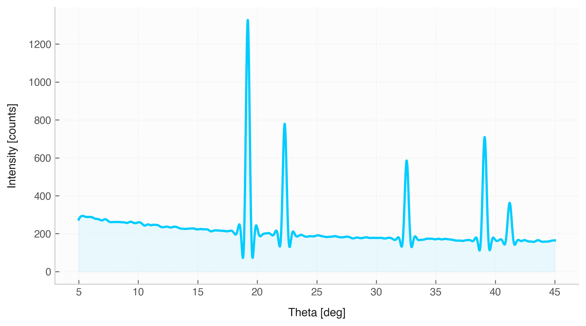

# Signal Filtering Methods

Digital filtering enables noise reduction, baseline smoothing, and frequency separation. The `Signal` class implements both time-domain smoothing algorithms and frequency-selective IIR digital filters.

---

## 1. Time-Domain Smoothing Filters

### `moving_average(window_size=5)`
* **Description:** Replaces each point with the mean of its local neighborhood over a uniform sliding window of length `window_size`.

| Parameter | Type | Default | Description |
| :--- | :--- | :--- | :--- |
| `window_size` | `int` | `5` | Number of adjacent points included in the averaging kernel. Must be $\ge 1$. |

---

### `savgol_filter(window_length=11, polyorder=2, **kwargs)`
* **Description:** Applies a Savitzky-Golay filter, which fits local polynomials of degree `polyorder` to smooth the signal without flattening peak heights.

| Parameter | Type | Default | Description |
| :--- | :--- | :--- | :--- |
| `window_length` | `int` | `11` | Length of the filter window (must be a positive odd integer). |
| `polyorder` | `int` | `2` | Order of the polynomial used to fit the samples. Must be less than `window_length`. |
| `**kwargs` | dict | | Additional key-value pairs passed directly to `scipy.signal.savgol_filter`. |

---

## 2. Frequency-Selective IIR Filters

All frequency-selective filters use zero-phase forward-backward filtering (`scipy.signal.filtfilt`) to prevent phase shift distortions.

### `lowpass_filter(cutoff, order=4, ftype="butter", fs=None, **kwargs)`
* **Description:** Attenuates frequencies above the specified `cutoff`.

### `highpass_filter(cutoff, order=4, ftype="butter", fs=None, **kwargs)`
* **Description:** Attenuates frequencies below the specified `cutoff`.

### `bandpass_filter(lowcut, highcut, order=4, ftype="butter", fs=None, **kwargs)`
* **Description:** Passes frequencies within `[lowcut, highcut]` while attenuating others.

### `bandstop_filter(lowcut, highcut, order=4, ftype="butter", fs=None, **kwargs)`
* **Description:** Rejects frequencies within `[lowcut, highcut]` (notch filter).

---

### Filter Design Parameters

| Parameter | Type | Default | Description |
| :--- | :--- | :--- | :--- |
| `cutoff` / `lowcut` / `highcut` | `float` / `Quantity` | *Required* | Critical frequency boundaries (in Hz or matching unit). |
| `order` | `int` | `4` | Filter order (determines roll-off steepness). |
| `ftype` | `str` | `"butter"` | Filter architecture type: `"butter"`, `"cheby1"`, `"cheby2"`, or `"ellip"`. |
| `fs` | `float` / `Quantity` / `None` | `None` | Custom sampling frequency. Uses `sampling_rate` if `None`. |
| `rp` | `float` | `1.0` | Passband ripple tolerance in dB (for `"cheby1"` and `"ellip"`). |
| `rs` | `float` | `40.0` | Minimum stopband attenuation in dB (for `"cheby2"` and `"ellip"`). |