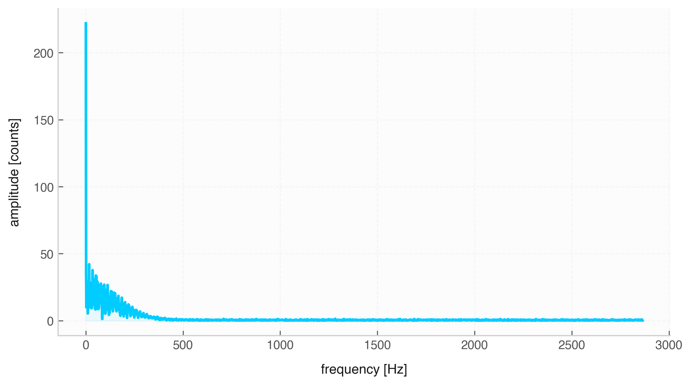

# Frequency Domain & Fourier Analysis

Spectral analysis decomposes signals into underlying frequency components. The `Signal` class integrates Fourier Transforms, Short-Time Fourier Transforms (STFT), and Power Spectral Density estimation (PSD).

---

## 1. Fast Fourier Transform (FFT)

### `fft(real_only=True)`
* **Description:** Computes the discrete Fourier transform amplitude spectrum.
* **Returns:** A new `Signal` instance mapping `frequency` (Hz) to `amplitude`.

| Parameter | Type | Default | Description |
| :--- | :--- | :--- | :--- |
| `real_only` | `bool` | `True` | If `True`, computes one-sided real FFT (`rfft`), doubling non-DC amplitudes. |

---

### `ifft(n=None, real_only=True, x_name="time", y_name="y")`
* **Description:** Inverse transformation to reconstruct a time-domain `Signal` from a frequency spectrum `Signal`.

| Parameter | Type | Default | Description |
| :--- | :--- | :--- | :--- |
| `n` | `int` / `None` | `None` | Length of the transformed output signal. |
| `real_only` | `bool` | `True` | Indicates if the source spectrum was created using real-only FFT. |
| `x_name` | `str` | `"time"` | Output label for the reconstructed $x$-axis. |
| `y_name` | `str` | `"y"` | Output label for the reconstructed $y$-axis. |

---

## 2. Time-Frequency Analysis (STFT)

### `stft(nperseg=256, noverlap=None, window="hann")`
* **Description:** Computes the Short-Time Fourier Transform for time-varying spectra.
* **Returns:** `(times, frequencies, Zxx)` matrix.

| Parameter | Type | Default | Description |
| :--- | :--- | :--- | :--- |
| `nperseg` | `int` | `256` | Length of each Fourier segment window. |
| `noverlap` | `int` / `None` | `None` | Number of overlapping samples between segments. Defaults to `nperseg // 2`. |
| `window` | `str` | `"hann"` | Window function type (e.g., `"hann"`, `"hamming"`, `"blackman"`). |

---

### `istft(Zxx, fs, window="hann", nperseg=None, noverlap=None, x_name="time", y_name="y")` *(Static Method)*
* **Description:** Reconstructs a time-domain `Signal` from a complex STFT matrix `Zxx`.

| Parameter | Type | Default | Description |
| :--- | :--- | :--- | :--- |
| `Zxx` | `np.ndarray` | *Required* | 2D complex matrix containing STFT STFT values. |
| `fs` | `float` / `Quantity` | *Required* | Sampling frequency of the original signal. |

---

## 3. Power Spectral Density (PSD)

### `psd(nperseg=None)`
* **Description:** Estimates power distribution across frequencies using Welch's average periodogram method.
* **Returns:** A new `Signal` mapping `frequency` to `psd` power values.

| Parameter | Type | Default | Description |
| :--- | :--- | :--- | :--- |
| `nperseg` | `int` / `None` | `None` | Length of segment windows used in Welch estimation. |