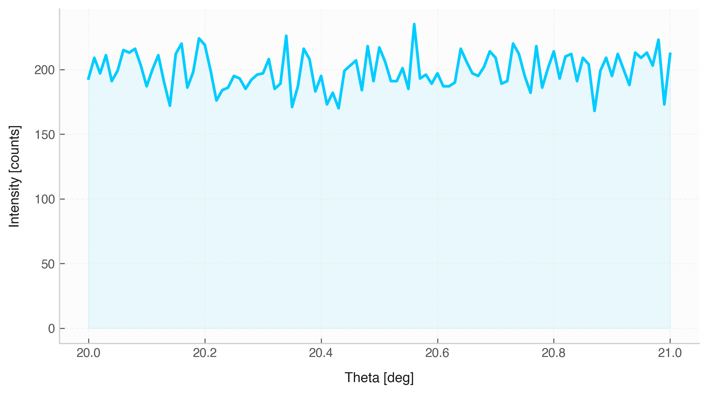

# Signal Operations & Sampling Analysis

This section details methods used for querying sampling parameters, cropping data boundaries, interpolating onto uniform grids, applying calculus operators, and extracting signal envelopes.

---

## 1. Sampling Properties

### `sampling_interval`
* **Description:** Calculates the mean spacing $\Delta x = \frac{1}{N-1} \sum (x_{i+1} - x_i)$ between consecutive sorted $x$ values.
* **Returns:** A scalar value (or `Quantity` with unit matching $x$).

### `sampling_rate`
* **Description:** Calculates the average sampling frequency $f_s = \frac{1}{\Delta x}$.
* **Returns:** A scalar or `Quantity` in inverse base units (e.g., $\text{s}^{-1}$ or $\text{Hz}$).

### `span`
* **Description:** Measures total signal span along the $x$-axis ($\max(x) - \min(x)$).

### `is_sorted()`
* **Description:** Checks if $x$-values are strictly non-decreasing. Returns `bool`.

### `is_uniform(rtol=1e-3)`
* **Description:** Evaluates whether $x$-values are evenly spaced within a relative tolerance.

| Parameter | Type | Default | Description |
| :--- | :--- | :--- | :--- |
| `rtol` | `float` | `1e-3` | Relative tolerance for testing equal intervals between samples. |

---

## 2. Domain Modification Methods

### `sort(ascending=True)`
* **Description:** Returns a new `Signal` sorted by $x$-values.

| Parameter | Type | Default | Description |
| :--- | :--- | :--- | :--- |
| `ascending` | `bool` | `True` | Sort order (ascending if `True`, descending if `False`). |

---

### `crop(x_min=None, x_max=None)`
* **Description:** Trims the signal to contain only samples satisfying $x_{\text{min}} \le x \le x_{\text{max}}$. Accepts raw numbers or unit-aware `Quantity` objects.

| Parameter | Type | Default | Description |
| :--- | :--- | :--- | :--- |
| `x_min` | `float` / `Quantity` / `None` | `None` | Lower bound cutoff for $x$. |
| `x_max` | `float` / `Quantity` / `None` | `None` | Upper bound cutoff for $x$. |

---

### `resample(n=None, dx=None)`
* **Description:** Performs 1D linear interpolation onto a perfectly uniform $x$-grid spanning $[\min(x), \max(x)]$. Exactly one of `n` or `dx` must be provided.

| Parameter | Type | Default | Description |
| :--- | :--- | :--- | :--- |
| `n` | `int` / `None` | `None` | Total number of output samples. |
| `dx` | `float` / `Quantity` / `None` | `None` | Step size between samples in the new grid. |

---

## 3. Mathematical Transforms

### `remove_offset()`
* **Description:** Subtracts the arithmetic mean of $y$ ($\mu_y$), centering the signal vertically around zero.

---

### `detrend(type="linear")`
* **Description:** Removes a constant or linear trend from $y$ using `scipy.signal.detrend`.

| Parameter | Type | Default | Description |
| :--- | :--- | :--- | :--- |
| `type` | `str` | `"linear"` | Trend type to remove: `"linear"` or `"constant"`. |

---

### `differentiate()`
* **Description:** Computes the discrete numerical derivative $\frac{dy}{dx}$ using central differences. Unit of output $y$ becomes $\frac{\text{unit}_y}{\text{unit}_x}$.

---

### `integrate()`
* **Description:** Computes cumulative trapezoidal integration $\int y \, dx$. Unit of output $y$ becomes $\text{unit}_y \cdot \text{unit}_x$.

---

### `envelope()`
* **Description:** Extracts the instantaneous amplitude envelope $A(t) = |y(t) + i \cdot \mathcal{H}\{y(t)\}|$ via the Hilbert transform.