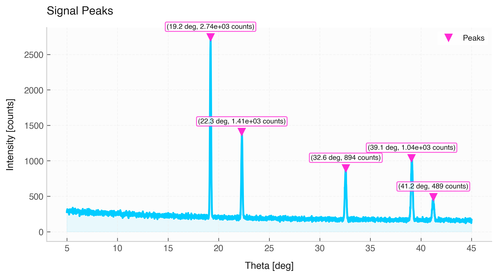

# Peak Detection & Visualization

The `Signal` class provides native routines for locating local extrema (peaks and valleys) and visualizing them directly using formatted plots.

---

## 1. Detection Algorithms

### `find_peaks(height=None, threshold=None, distance=None, prominence=None, width=None, **kwargs)`
* **Description:** Identifies local maxima based on structural constraints such as peak height, separation distance, and prominence.
* **Returns:** `(peaks_signal, properties)` where `peaks_signal` is a sliced `Signal` containing only peak points, and `properties` is a dictionary containing peak measurements.

| Parameter | Type | Default | Description |
| :--- | :--- | :--- | :--- |
| `height` | `float` / `Quantity` | `None` | Minimum required absolute height of peaks. |
| `threshold` | `float` / `Quantity` | `None` | Minimum vertical distance to neighboring samples. |
| `distance` | `float` | `None` | Minimum horizontal separation (in sample count) between neighboring peaks. |
| `prominence` | `float` / `Quantity` | `None` | Minimum vertical height of a peak relative to surrounding baselines. |
| `width` | `float` | `None` | Minimum required width of peaks in sample indices. |
| `**kwargs` | dict | | Additional parameters passed to `scipy.signal.find_peaks`. |

---

### `find_valleys(height=None, threshold=None, distance=None, prominence=None, width=None, **kwargs)`
* **Description:** Identifies local minima (troughs) by internally inverting the signal ($-y$) and running peak detection.
* **Returns:** `(valley_signal, properties)` matching the output structure of `find_peaks`.

---

## 2. Peak Visualization

### `plot_peaks(height=None, threshold=None, distance=None, prominence=None, width=None, ax=None, figsize=(8, 4.5), title="Signal Peaks", xlabel=None, ylabel=None, grid=True, **kwargs)`
* **Description:** Renders the original signal curve, marks identified peak locations using secondary-color markers, and anchors callout boxes containing precise $(x, y)$ coordinate text annotations for each peak.

| Parameter | Type | Default | Description |
| :--- | :--- | :--- | :--- |
| `ax` | `matplotlib.axes.Axes` | `None` | Target plot axis. If `None`, a new figure is initialized. |
| `figsize` | `tuple` | `(8, 4.5)` | Figure width and height in inches. |
| `title` | `str` | `"Signal Peaks"` | Text label for plot title. |
| `xlabel` / `ylabel` | `str` / `None` | `None` | Custom axis labels. Uses default column names if `None`. |
| `grid` | `bool` | `True` | Displays background grid lines if `True`. |