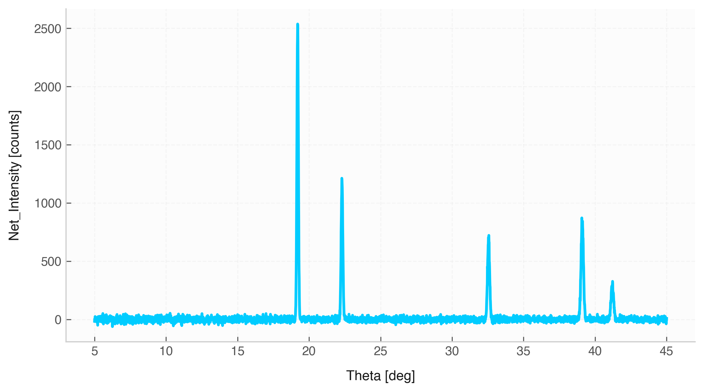

# Signal Class: Overview & Instantiation

The `Signal` class is a specialized structure designed for two-column numerical datasets $(x, y)$, commonly representing **time vs. amplitude** or **frequency vs. power**. It inherits from `Data` while incorporating physical unit tracking, uncertainty propagation, resampling, digital filtering, and spectral analysis.



---

## 1. Class Initialization (`__init__`)

### Description
The constructor creates a `Signal` instance from various inputs, including existing `Data` objects, dictionaries, or raw array-like sequences (Python lists, NumPy arrays, or physical `Quantity` objects).

### Method Signature
```python
Signal(data=None, x=None, y=None, *, x_name="x", y_name="y", copy=True)
```

### Parameter Reference

| Parameter | Type | Default | Description |
| :--- | :--- | :--- | :--- |
| `data` | `Data`, `dict`, array-like, or `None` | `None` | The source data container or the first array ($x$-values) if passing positional arrays. |
| `x` | `str`, array-like, or `None` | `None` | The column name for $x$ (if `data` is provided) or the array of $x$-values. |
| `y` | `str`, array-like, or `None` | `None` | The column name for $y$ (if `data` is provided) or the array of $y$-values. |
| `x_name` | `str` | `"x"` | Label assigned to the $x$ axis when constructing from raw arrays. |
| `y_name` | `str` | `"y"` | Label assigned to the $y$ axis when constructing from raw arrays. |
| `copy` | `bool` | `True` | If `True`, deep-copies input arrays to ensure input data isolation. |

---

## 2. Properties and Accessors

### Core Properties

| Property | Return Type | Description |
| :--- | :--- | :--- |
| `x_name` | `str` | Returns the column name used for the independent variable ($x$). |
| `y_name` | `str` | Returns the column name used for the dependent variable ($y$). |
| `x` | `Quantity` / `np.ndarray` | Accesses or updates the full $x$ column (preserving units and uncertainties). |
| `y` | `Quantity` / `np.ndarray` | Accesses or updates the full $y$ column (preserving units and uncertainties). |
| `x_values` | `np.ndarray` | Raw numeric array of $x$, stripped of physical units. |
| `y_values` | `np.ndarray` | Raw numeric array of $y$, stripped of physical units. |
| `x_error` | `np.ndarray` | Array of standard uncertainties associated with $x$ (zeros if unspecified). |
| `y_error` | `np.ndarray` | Array of standard uncertainties associated with $y$ (zeros if unspecified). |
| `x_unit` | `Unit` | Physical unit object associated with $x$ (`DIMENSIONLESS` if unassigned). |
| `y_unit` | `Unit` | Physical unit object associated with $y$ (`DIMENSIONLESS` if unassigned). |

---

## 3. Usage Examples

```python
import numpy as np
from mymodule import Signal, Quantity, Unit, SECOND, VOLT

# Constructing from raw arrays with physical units
t = Quantity(np.linspace(0, 1, 100), SECOND)
v = Quantity(np.sin(2 * np.pi * 5 * t.value), VOLT)

sig = Signal(t, v, x_name="Time", y_name="Voltage")

print(sig.x_unit)   # Output: s
print(sig.y_unit)   # Output: V
```