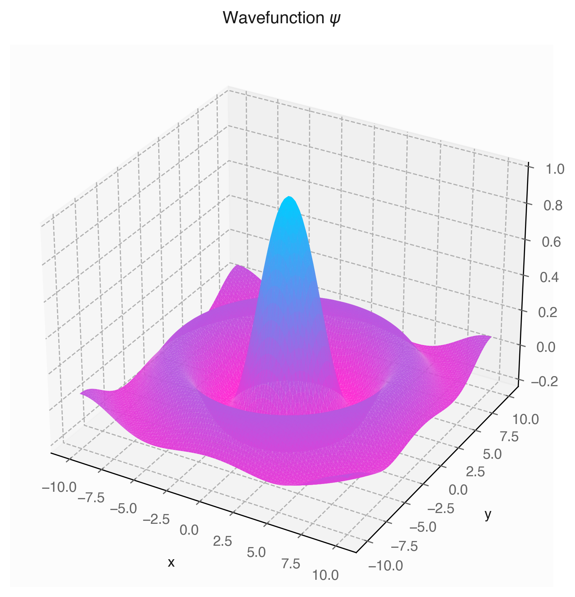

# 3D Surface Plot (`Data.surface_3d`)



The `.surface_3d()` method constructs a 3D triangulated surface (`plot_trisurf`) directly from three 1D `Data` columns `(x, y, z)`, eliminating the need to manually reshape scattered coordinates into 2D meshgrids.

## Features & Internal Behavior

* **Delaunay Triangulation (`plot_trisurf`):** Works natively with unstructured or flattened 1D `(x, y, z)` columns stored in a `Data` object.
* **Brand-Consistent Colormap:** Defaults to a smooth linear gradient transitioning between the active style's secondary and primary colors when `cmap=None`.
* **Unit Label Extraction:** Automatically populates the `x`, `y`, and `z` axis labels with column names and unit symbols from the active unit scheme.

## Basic Usage

```python
import numpy as np
import elevenone as eo
from elevenone import Data
from elevenone.basic_units import m, K

grid = np.linspace(-2, 2, 30)
X, Y = np.meshgrid(grid, grid)
Z = 300 + 50 * np.exp(-(X**2 + Y**2))

dataset = Data({
    "X": X.ravel() * m,
    "Y": Y.ravel() * m,
    "Temperature": Z.ravel() * K
})

# Generate triangulated 3D surface plot
fig, ax = dataset.surface_3d(x="X", y="Y", z="Temperature", title="2D Gaussian Thermal Profile")

```

## Parameter Reference

| Parameter | Type | Default | Description |
| --- | --- | --- | --- |
| `x` | `str` | *required* | X-axis coordinate column name. |
| `y` | `str` | *required* | Y-axis coordinate column name. |
| `z` | `str` | *required* | Z-axis height/value column name. |
| `ax` | `Axes3D` | `None` | Existing Matplotlib 3D axes object. |
| `figsize` | `tuple` | `(8, 6)` | Figure dimensions `(width, height)`. |
| `cmap` | `Colormap` | `None` | Surface colormap (defaults to active theme gradient). |
| `edgecolor` | `str` | `'none'` | Color of triangle mesh edges (`'none'` for smooth shading). |
| `alpha` | `float` | `1` | Surface opacity (0.0 to 1.0). |
| `title` | `str` | `None` | Chart title. |
| `xlabel` | `str` | `None` | Custom x-axis label override. |
| `ylabel` | `str` | `None` | Custom y-axis label override. |
| `zlabel` | `str` | `None` | Custom z-axis label override. |
| `grid` | `bool` | `True` | Enables 3D background grid planes. |
