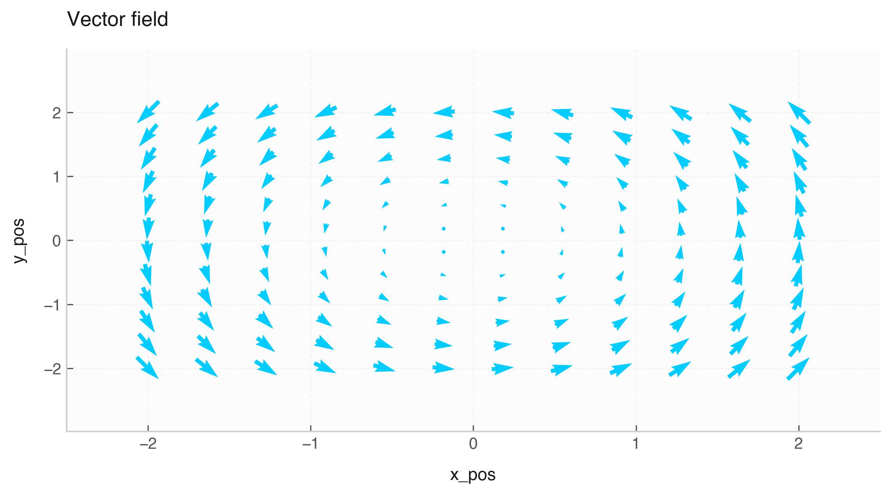

# Vector Field Plot (`Data.vector_field`)



The `.vector_field()` method renders a 2D vector field from coordinate columns `(x, y)` and vector component columns `(u, v)`. It includes an automatic collision-avoidance algorithm that sizes arrows so neighboring vectors do not overlap.

## Features & Internal Behavior

* **Automatic Overlap Prevention:** Calculates the maximum arrow length that prevents segment collisions between neighboring points, scaled by `gap` and bounded by `max_length`.
* **Proportional vs. Uniform Scaling (`scale`):** By default (`scale=None`), arrow lengths scale proportionally to vector magnitude $\vert{}(u, v)\vert{}$. Passing a numeric `scale` normalizes all non-zero arrows to equal length, making field topology easy to read even in regions of weak magnitude.
* **Magnitude Color Mapping (`color_by_magnitude=True`):** Colors arrows according to their physical magnitude $\vert{}(u, v)\vert{}$ and attaches a labeled colorbar with appropriate units.
* **Unit Label Extraction:** Automatically formats axis and colorbar labels using column names and active unit symbols.

## Basic Usage

```python
import numpy as np
import elevenone as eo
from elevenone import Data
from elevenone.basic_units import m, V

grid_1d = np.linspace(-2, 2, 12)
X, Y = np.meshgrid(grid_1d, grid_1d)
x, y = X.ravel(), Y.ravel()

# Rotational field components
u = -y
v = x

dataset = Data({
    "x": x * m,
    "y": y * m,
    "Ex": u * (V / m),
    "Ey": v * (V / m)
})

# Plot uniform-length arrows colored by physical field magnitude
fig, ax = dataset.vector_field(
    x="x", y="y", u="Ex", v="Ey",
    scale=0.85,
    color_by_magnitude=True,
    title="2D Vector Field"
)

```

## Parameter Reference

| Parameter | Type | Default | Description |
| --- | --- | --- | --- |
| `x` | `str` | *required* | X-coordinate position column name. |
| `y` | `str` | *required* | Y-coordinate position column name. |
| `u` | `str` | *required* | X-component vector column name. |
| `v` | `str` | *required* | Y-component vector column name. |
| `ax` | `matplotlib.axes.Axes` | `None` | Existing Matplotlib axes object. |
| `figsize` | `tuple` | `(8, 4.5)` | Figure dimensions `(width, height)`. |
| `scale` | `float` | `None` | `None` for magnitude-proportional lengths; a float `s` draws all arrows with equal length as a fraction of the max overlap-free size. |
| `angles` | `str` | `'uv'` | `'uv'` computes screen angle via `atan2(v, u)`; `'xy'` aligns arrows with data coordinate axes. |
| `pivot` | `str` | `'middle'` | Anchor point of each arrow (`'tail'`, `'middle'`, or `'tip'`). |
| `color` | `str` | `None` | Uniform arrow color (ignored when `color_by_magnitude=True`). |
| `color_by_magnitude` | `bool` | `False` | Colors arrows by physical vector magnitude $\vert{}(u, v)\vert{}$ and adds a colorbar. |
| `cmap` | `Colormap` | `None` | Custom Matplotlib colormap for magnitude coloring. |
| `max_length` | `float` | `0.12` | Upper bound for arrow length as a fraction of axes width. |
| `gap` | `float` | `0.85` | Fraction ($\le 1$) of the maximum overlap-free length actually drawn. |
| `overlap_tolerance` | `float` | `0.05` | Fraction of arrows (`0` to `1`) permitted to touch in irregular point clouds. |
| `title` | `str` | `None` | Chart title. |
| `xlabel` | `str` | `None` | Custom x-axis label override. |
| `ylabel` | `str` | `None` | Custom y-axis label override. |
| `grid` | `bool` | `True` | Enables background grid lines. |
