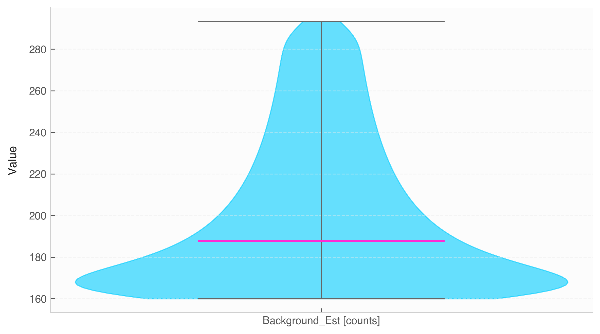

# Violin Plot (`Data.violin`)



The `.violin()` method visualizes kernel density distributions across numerical variables, combining box plot features with probability density shapes.

## Features & Internal Behavior

* **Density Estimation:** Shows the probability density of dataset variables at different values.
* **Median Lines:** Highlights distribution medians clearly using secondary accent colors.
* **Automatic Multi-Column Comparison:** Plots all numerical variables in the `Data` instance when `columns=None`.

## Basic Usage

```python
import numpy as np
import elevenone as eo
from elevenone import Data
from elevenone.basic_units import mV

np.random.seed(0)
dataset = Data({
    "Sensor_A": np.random.normal(50, 5, 100) * mV,
    "Sensor_B": np.random.normal(55, 12, 100) * mV
})

# Create violin plot
fig, ax = dataset.violin(title="Sensor Output Density Comparison")
```

## Parameter Reference

| Parameter | Type | Default | Description |
| :--- | :--- | :--- | :--- |
| `columns` | `list` | `None` | List of numerical column names to plot. |
| `ax` | `matplotlib.axes.Axes` | `None` | Matplotlib axes object. |
| `figsize` | `tuple` | `(8, 4.5)` | Figure dimensions. |
| `title` | `str` | `None` | Chart title. |
| `ylabel` | `str` | `'Value'` | Label for $y$-axis. |
| `grid` | `bool` | `True` | Toggles background horizontal grid. |